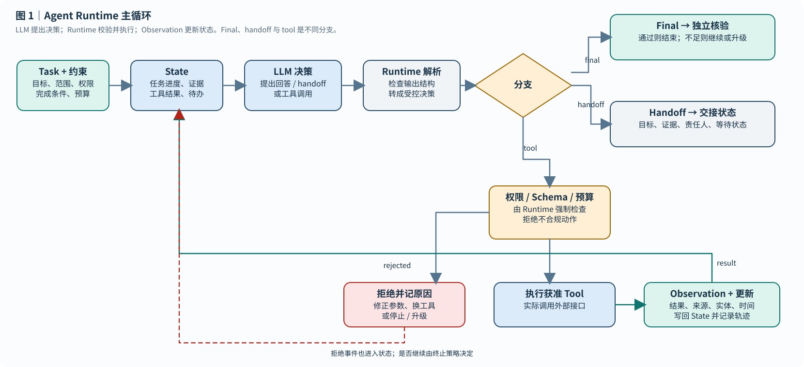
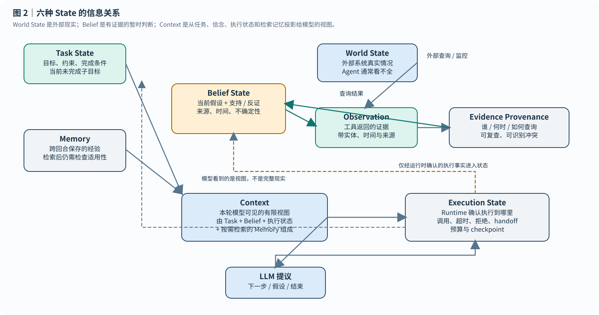
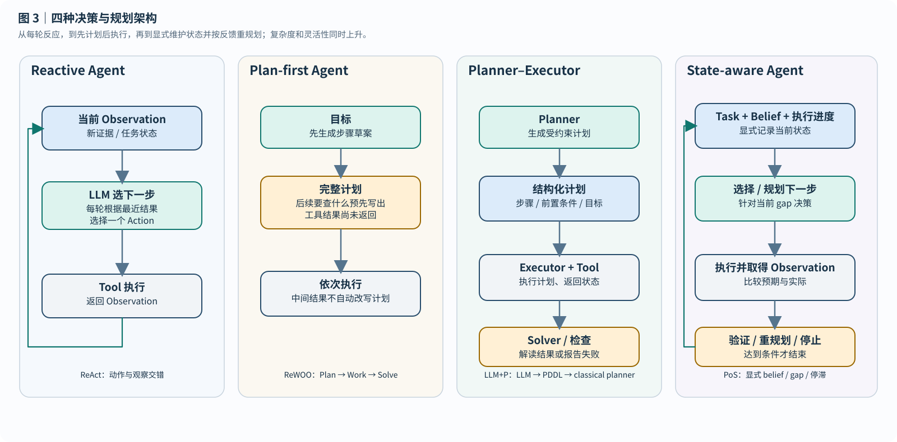
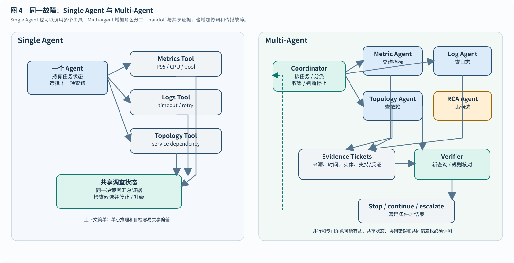
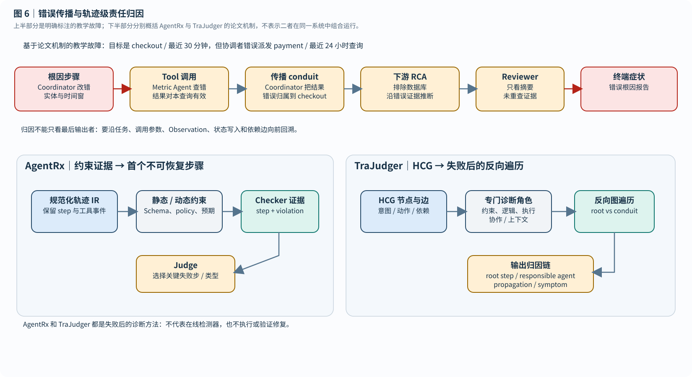
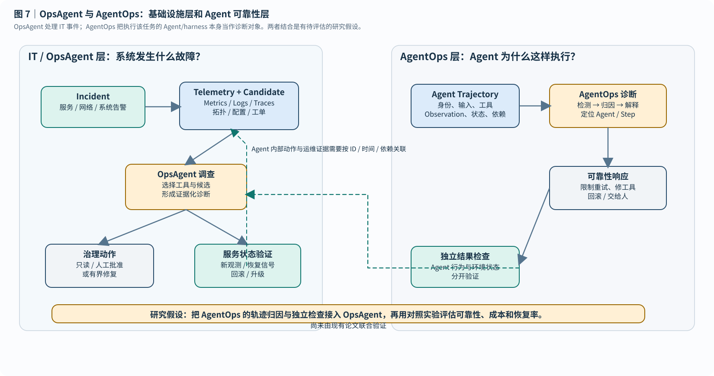
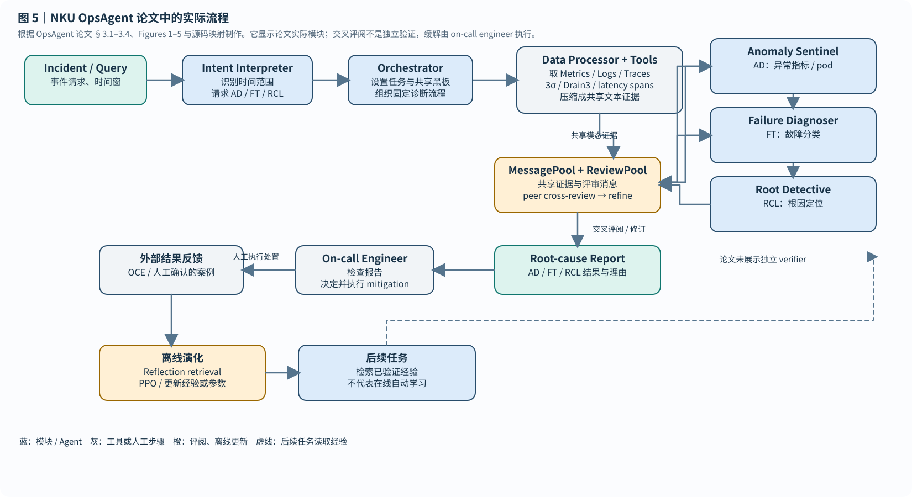

# Lesson 2：Agent 的状态、决策、规划与多智能体协作

> 本课沿着一个微服务延迟故障，观察 Agent 如何接收任务、维护状态、选择行动、调用工具、协作、验证，并在失败后定位责任。分层图和运行时伪代码是教学模型；论文案例会单独标注，避免把教学简化误认为论文原系统。

**本课术语约定**：LLM（大语言模型）；AIOps（智能运维）；RCA（根因分析）；Runtime（运行时控制程序）。M/L/T 分别指 Metrics（指标）、Logs（日志）、Traces（调用追踪）。

**案例标记**

- **论文真实案例**：论文直接描述或评估的案例，并注明章节、图表或实验范围。
- **基于论文机制的教学演示**：使用论文确实提出的机制，输入与数值为本课构造。
- **独立虚构教学案例**：只解释通用概念，不代表任何论文或生产事件。

**贯穿案例**：某微服务请求延迟突然升高。起初只知道用户影响和时间范围；CPU 看起来正常，连接池等待时间上升，日志出现超时。我们逐步判断哪些是观测、哪些是猜测、谁应继续调查，以及什么证据足以结束诊断。

## 全局图：从任务到可验证结论

一套 Agent 系统可以看作受控的状态转移过程。模型根据当前视图提出行动；运行时（Runtime，负责解析、授权、执行与记录的程序）决定行动是否合法；工具或环境返回新的观测；状态更新后进入下一轮。模型输出是候选决策，不等于已经执行的动作，也不等于事实。

~~~text
任务与约束
  → Runtime 初始化任务状态、权限、预算和终止条件
  → 构造本轮 Context（模型输入视图）
  → LLM 提出 Continue / Tool Call / Handoff / Final
  → Runtime 校验结构、权限、预算与风险
  → 执行允许的工具或转交给指定角色
  → 收集 Observation（外部观测）和 Verification（验证结果）
  → 更新状态与轨迹
  → 继续、升级给人，或带证据结束
~~~

*图 1. Agent Runtime 的教学流程。Final、Continue、Escalate 是运行时中的不同终止或控制分支；不同生产系统的决策类型可能不同。可编辑源见 [agent-runtime.mmd](assets/lesson-02/agent-runtime.mmd)。*

---

# Part 1 — 从 Agent Loop 到真正的 Agent Runtime

## 1. 循环中的对象

| 对象 | 含义 | 微服务案例 |
|---|---|---|
| Task（任务） | 要达到的结果和边界 | 找出延迟升高原因；只读调查；五分钟内报告 |
| State（状态） | 当前已知、未知、执行到哪一步 | 观测、假设、调用历史、预算、未完成检查 |
| Observation（观测） | 从环境或工具收到的数据 | 延迟分位数、连接池等待、日志样本 |
| Decision（决策） | 下一步行动的结构化提议 | 查询服务过去 15 分钟的连接池指标 |
| Action（动作） | 被 Runtime 接受并准备执行的命令 | 按受限参数调用 Metrics API |
| Tool（工具） | 读取或影响外部系统的接口 | 指标、日志、拓扑查询，或重启接口 |
| State Update（状态更新） | 把结果写回任务状态 | 将“连接等待升高”加入证据并降低“CPU 饱和”假设 |
| Termination（终止） | 判断任务结束、继续或升级 | 证据充分时报告；不足或需写操作时升级 |

**为什么需要 Agent Runtime？** 只有模型调用时，系统没有强制的权限边界、超时、预算、重试规则、状态持久化、工具结果校验和可审计轨迹。Runtime 是模型与环境之间的控制边界。模型可解释数据、提出查询计划和生成假设；确定性代码应检查结构、权限、预算和工具参数，并执行获准调用。

Agent Loop（智能体循环）只描述“输入—决策—行动—反馈”的重复结构；Runtime 还包含解析、授权、调度、取消、错误处理和记录。不是每一轮都必须调用 LLM：缓存、确定性规则、重试策略和终止检查都可由普通程序执行。

## 2. 逐步阅读 Agent 主循环

下面是**教学伪代码**，不是可直接运行的 Python。model_decide 表示 LLM 生成行动提议；所有真实工具调用都由 Runtime 完成。

~~~python
# 根据目标初始化状态，同时写入硬约束、工具白名单、预算和截止时间。
# 输出 state；它是结构化任务状态，不是把全部聊天记录原样拼起来。
state = initialize(task, constraints, allowed_tools, budget, deadline)

# 终止判断由 Runtime 执行，不能让模型说“完成”就直接结束。
# 终止条件包括目标已验证、预算/时间耗尽、策略拒绝或需要人工接管。
while not runtime_terminal(state):

    # 从 State 中挑选本轮需要的信息，形成模型视图。
    # 全部历史可能过长、过时或矛盾，因此只提供相关证据和待办。
    context = build_model_view(state)

    # LLM 只提出结构化决策；此刻尚未调用工具，也没有改变外部环境。
    # 输出可能是 final、tool_call、handoff 或 continue。
    proposal = model_decide(context)

    # Runtime 解析输出；格式错误、未知字段或不支持的动作不能执行。
    decision = parse_decision(proposal)

    # 模型提出 final 时，Runtime 仍检查是否满足任务证据门槛。
    if decision.kind == "final":
        # 检查结论是否带证据、是否覆盖请求、是否有未解决的关键矛盾。
        # 模型文字“我已验证”本身不是验证证据。
        result = verify_completion(decision, state)

        # 记录完成检查、判定和证据来源，供审计和事后诊断。
        record_trace(state, event="completion_check", result=result)

        # 只有通过完成条件才返回；否则把缺口写回待办。
        if result.passed:
            stop_with_reason(state, reason="verified_complete")
            return emit_answer(decision, evidence=result.evidence)

        # Final 检查失败：保存缺口，下一轮补查或升级。
        state = update_state(state, verification_gap=result.gaps)
        continue

    # 模型提出 handoff（交接）时，Runtime 检查接收角色和必需上下文。
    if decision.kind == "handoff":
        # 交接须带范围、现有证据、未验证假设和待回答问题。
        handoff_check = validate_handoff(decision, state)

        if handoff_check.allowed:
            # Runtime 只传递最小充分上下文，并记录交接依赖边。
            receipt = dispatch_handoff(decision, state)
            state = update_state(state, handoff=receipt)
            record_trace(state, event="handoff", receipt=receipt)
            continue

        # 接收者未知或字段缺失时不能伪造接收成功。
        stop_with_reason(state, reason=handoff_check.reason)
        return escalate_to_human(state)

    # 除交接和结束外，剩余决策必须是受支持的工具调用。
    if decision.kind != "tool_call":
        stop_with_reason(state, reason="unsupported_decision")
        return escalate_to_human(state)

    # Runtime 检查参数 schema、工具权限、调用次数、成本与风险等级。
    # 结果是明确的允许/拒绝，而不是由 LLM 自行判断。
    check = validate_schema_permission_budget(
        decision.tool, decision.arguments, state.policy, state.budget
    )

    # action is rejected：有任何一项校验失败都不得触达工具。
    if not check.allowed:
        # 记录被拒绝字段及策略依据；不可把拒绝伪装成“没有发现异常”。
        record_trace(state, event="action_rejected", reason=check.reason)
        state = update_state(state, blocked_action=decision, reason=check.reason)

        # 可安全改写的临时错误可以重试；越权/高风险动作应升级或停止。
        if check.retryable and not check.requires_human:
            continue
        stop_with_reason(state, reason="policy_or_risk_block")
        return escalate_to_human(state)

    # 只有校验通过后 Runtime 才执行工具；LLM 不直接持有生产凭据。
    # 工具设置超时、读写范围和幂等策略。
    try:
        observation = execute_allowed_tool(
            decision.tool, decision.arguments, timeout=check.timeout
        )
    except ToolError as error:
        # 工具失败不是“没有发现问题”；要记录错误及安全重试性。
        record_trace(state, event="tool_error", error=error)
        state = update_state(state, tool_failure=error)
        if retry_is_safe(error, decision, state):
            continue
        stop_with_reason(state, reason="tool_failure_requires_review")
        return escalate_to_human(state)

    # 规范化工具响应并附时间、查询范围、来源和完整性。
    # 新观测先进入证据区，不自动等同于根因。
    normalized = normalize_observation(observation, decision)
    state = update_state(state, observation=normalized)

    # 记录身份、提议、校验、工具、输出和状态变化，便于重放与归因。
    record_trace(state, event="tool_observation", observation=normalized)

    # 状态机检查目标进度、矛盾、预算和待办，再决定下一步。
    state = reconcile_task_state(state)
~~~

### 具体执行例子：CPU 正常，连接池等待升高

这是**独立虚构教学案例**。用户要求调查 checkout 延迟，策略只允许读指标、日志和拓扑。

1. Runtime 初始化目标、最近 15 分钟时间窗、工具白名单和“不得重启”约束。
2. 模型提出查询 CPU、请求延迟和连接池等待。Runtime 检查服务、时间窗与权限，再调用指标工具。
3. 工具返回 CPU 正常、p99 延迟升高、连接池等待升高。Runtime 保存来源和查询时间；这些是观测，不是最终根因。
4. 模型提出“连接池争用”假设，并请求查询 DB 连接数和连接获取超时日志。
5. 若日志请求越权，校验拒绝动作；轨迹记录“查询被拒绝”，不能推断“没有超时”。
6. 若新证据显示连接等待升高但 DB CPU 正常，状态记录“连接池争用有支持，数据库 CPU 饱和缺乏支持”，继续检查连接上限、调用耗时和上游重试。
7. 只有证据门槛满足才报告 RCA；缺关键数据则说明不确定性并升级。

**本节你应该理解什么**

- Agent Loop 是状态转移循环；Runtime 还管权限、预算、工具执行、错误处理和轨迹。
- 模型输出工具提议，与工具通过校验并执行，是两个不同事件。
- Final 要过完成检查；Escalate 是有效结果，不代表系统失败。
- 易混淆：把 LLM 自述的验证当成独立证据。
- 思考：工具查询被权限层拒绝时，状态应记录“没有数据”还是“查询被拒绝”？为什么？

---

# Part 2 — Agent 的 State：它知道什么、相信什么、做到哪一步？

## 1. 六种状态不是六个同义词

| 状态视角 | 回答的问题 | 微服务例子 | 常见来源 |
|---|---|---|---|
| Context（上下文） | 本轮模型实际看到了什么？ | 当前目标、最近证据、工具 schema、待办 | Runtime 裁剪 |
| Memory（记忆） | 过去任务有哪些可能有用的经验？ | 过去连接池泄漏案例及适用条件 | 历史库、案例库 |
| Belief State（信念状态） | 当前对环境有哪些可撤销判断及证据？ | “连接池争用”有支持，尚未排除流量突增 | 观测与推理更新 |
| World State（世界状态） | 外部系统有哪些实体、关系与可观测配置？ | checkout 调用 inventory，后者访问 DB | 拓扑、配置、遥测 |
| Task State（任务状态） | 用户目标有哪些子目标，哪些完成/未完成？ | 已确认延迟异常；根因验证待办 | 编排器与完成条件 |
| Execution State（执行状态） | 系统做过什么、还可做什么？ | 已调用 4 次工具，预算余 6 | Runtime、队列、调用记录 |

Context 是“送进这一轮模型的视图”，并非模型的全部记忆；Memory 是可检索的历史；Belief 是对当前任务的暂定判断；World State 描述外界；Task State 管理目标进度；Execution State 管理系统执行控制。它们可以放在同一对象或分散在数据库、事件流和工具中。

### 保存全部聊天记录为何不等于理解当前环境？

聊天记录通常保留语言，但不保证结构完整：旧判断可能已被新证据推翻；时间窗可能混在一起；工具调用可能失败；外部服务还会变化。若把全部对话再次送给模型，它可能把“曾经怀疑 DB 饱和”读成事实，或漏掉“查询失败”。

更稳妥的记录方式是带来源、时间、状态的结构化证据。例如，“连接池等待 p95=820ms，来源 Metrics API，窗口 14:00–14:15，查询成功”与“可能连接池争用，支持证据 A、反证 B，状态待验证”分开保存。

*图 2. 六种状态视角的信息关系。Memory 可影响当前假设，但历史案例不能替代当前观测；Context 是一轮模型输入的投影。可编辑源见 [agent-state.mmd](assets/lesson-02/agent-state.mmd)。*

## 2. 一份可读的任务状态对象

下面是**教学抽象**，不是 OpsMem、PoS 或 Graph of States 原代码的数据结构。

~~~yaml
task:
  goal: "解释 checkout 最近 15 分钟 p99 延迟上升"
  constraints: ["只读调查", "不得执行配置变更", "10 分钟内汇报"]
  status: "investigating"
world:
  entities: ["checkout", "inventory", "db-main"]
  relations: ["checkout -> inventory", "inventory -> db-main"]
beliefs:
  - claim: "连接池争用正在增加 checkout 延迟"
    status: "supported_but_unconfirmed"
    support: ["连接获取等待升高", "超时日志增加"]
    counterevidence: ["db-main CPU 正常"]
    confidence: "中"
    source_time: "14:00–14:15 UTC"
memory_hits:
  - case: "历史连接池泄漏案例"
    applicability: "需检查版本、流量与池配置是否相似"
execution:
  completed: ["查询 checkout 延迟", "查询连接池等待"]
  pending: ["检查调用超时", "核对部署变更"]
  tool_calls: 4
  remaining_budget: 6
verification:
  required: ["独立复核相关指标", "检查替代原因"]
~~~

逐字段解释：

- task.goal 是成功条件目标；constraints 是硬边界；status 由状态机管理，不能让模型随意改成 complete。
- world.entities/relations 是本任务依赖视图，不一定是完整真实拓扑；还要标记版本和来源。
- beliefs 保存主张、证据、反证、时间窗和确认状态。冲突时先查时间对齐、采样和来源质量，不要用平均置信度消掉矛盾。
- memory_hits 是被召回的先例和适用条件；命中并不代表当前故障相同。
- execution.completed/pending/tool_calls 是进度与预算，供 Runtime 控制循环。
- verification.required 是完成门槛；由任务风险决定需检查什么。

## 3. 证据怎样更新信念？

**基于论文机制的教学演示**：连接池等待指标升高、日志超时增加，支持“连接池争用”；DB CPU 正常会削弱“数据库计算饱和”，但不能证明 DB 连接管理正常。后来发现应用发布改变了池最大连接数，可增加该假设的支持；若拓扑显示流量没有经过该连接池，则构成反证。

合格的状态更新至少保留原主张、证据来源、观测时间、适用范围、支持/反证、更新动作和缺口。冲突时可维持多个候选，不强迫单一答案。信念更新可由规则或 LLM 协助，但证据来源与工具结果应由运行时保留。

## 4. 论文案例：OpsMem、PoS 与 Graph of States

### OpsMem：当前事件图与跨事件经验

**问题**：故障现场短期证据和跨事件历史知识往往分散；单纯把历史文本塞进 Prompt 容易忽略当前故障演化，也难判断旧经验是否适用。

**设计与执行**：OpsMem 用 short-term memory（STM，短期记忆）表示当前事件诊断状态，用 long-term memory（LTM，长期记忆）保存跨事件模式、案例和处置知识。Cross-Memory Resonance（跨记忆共振）根据当前任务与事件图更新历史记忆激活，再将相关经验送入诊断上下文。论文系统围绕中心 Agent、专家 Agent 和受限交互推进调查。公开仓库只有整理过的案例/小型种子知识库，不能声称公开了生产环境的完整 LTM。

**流程**：当前遥测更新事件图 → 由当前图形成检索/激活信号 → LTM 相关模式被激活 → 记忆与当前证据共振 → 生成待验证线索 → Agent 继续调查。记忆提案涉及受控应用/审核，不是任意写入都自动成为知识。

**局限**：历史相关不等于因果相关；错误或过期案例会误导。检索命中不是当前故障的证明。论文评测范围与长期生产漂移仍有差别。

**与本课的关系**：Memory 可帮助 Belief 更新，但二者必须分开：记忆是候选经验，信念是针对当前事件的暂定主张。

来源：[OpsMem 论文笔记](../../papers/opsagent/opsmem.md)，Sec. II–V、表格和消融；同一笔记记录官方源码的 CentralAgent.run 与 CrossMemoryResonance.run。

### PoS：显式信念、目标与缺口

PoS（Planning over State，围绕状态规划）将信念表示拆成世界状态、目标、证据差距和行动差距等部分，论文写作 B_t=(W_t,G,ΔE_t,ΔA_t)。系统因此能分别表示“环境是什么”“目标是什么”“缺哪些事实”“缺哪些动作”。Task Agent 提议状态变化；Belief Sentinel 检查支持关系和一致性；进度信号关注停滞、重复和回退。恢复规划会产生约束，引导后续动作；论文中的恢复约束生成不是自动选择并执行生产操作。

**局限**：显式结构可让缺口更可见，但状态抽取仍可能错；受限规划也可能把错误信念变成错误限制。论文是预印本和受控基准评估，不能据此宣称通用生产效果。

来源：[PoS 论文笔记](../../papers/opsagent/pos.md)，Sec. 3.1–3.3、Fig. 2、Sec. 4 的基准与表格。

### Graph of States：把假设和证据放进图中

Graph of States 用图组织假设/状态及证据支持或反驳关系；图的前沿和缺口帮助选择下一项调查，并允许回退和重新探索。问题从“生成最可能的一段解释”变成“哪些候选已有证据、哪些关键证据仍缺”。

**边界**：论文展示溯因诊断与图上调查，不是自动修复系统。论文报告的 benchmark 指标只适用于论文设置，不代表所有 IT 故障或网络场景的普适准确率。

来源：[Graph of States 笔记](../../papers/opsagent/graph-of-states.md)，Sec. 3.1–3.3、Fig. 2、Sec. 4 / Table 3。

**本节你应该理解什么**

- Context 是模型本轮看到的内容；Memory 是历史经验；Belief 是当前可修订的判断。
- World、Task、Execution State 分别描述外部环境、目标进度和运行控制。
- 证据冲突要保留来源、时间和范围；必要时保留多个候选。
- 易混淆：长期记忆召回不是当前故障的证明。
- 思考：若历史案例很相似但服务版本和拓扑不同，Agent 应如何表达其适用性未知？

---

# Part 3 — Reasoning、Planning 与 Replanning

## 1. 六个概念

- Reasoning（推理）：根据已有信息形成解释或比较选项。
- Planning（规划）：选择达到目标的行动序列，并考虑依赖、成本和约束。
- Plan Execution（计划执行）：按计划调用工具/完成子任务，并记录真实结果。
- Search（搜索）：在候选动作或状态空间探索、比较路径。
- Replanning（重规划）：执行反馈改变状态或计划可行性后，重新选择后续动作。
- Verification（验证）：用预先定义的检查确认主张或目标是否达到。

“先想再调用工具”不自动等于 Planning。计划至少要有目标、行动、依赖或条件；重规划还要使用执行后的 Observation 改变计划。

*图 3. 四种教学控制形态。真实论文可能只实现一部分；预生成固定计划不等于动态重规划。源：[planning-comparison.mmd](assets/lesson-02/planning-comparison.mmd)。*

## 2. 常见控制形态

### Reactive Agent（反应式 Agent）

观察后立即选下一动作，例如“看到超时日志，就查相关服务”。反馈快、结构简单，但易局部贪心、重复查询，不一定掌握目标全貌。适合动作简单、反馈快、长程依赖少的任务。

### Plan-first Agent（先计划后执行）

先生成步骤清单，再顺序执行，如先查时延、再查拓扑、再读日志。它能预估成本、暴露依赖；缺点是初始计划基于不完整信息，若无反馈分支就会沿错误路径继续。

### Planner–Executor（规划器—执行器）

规划器输出任务，Executor 执行工具并返回结果。职责分离有利于结构化计划和受控执行；但若 Planner 不读取新 Observation，计划仍静态。

### State-aware Agent（状态感知 Agent）

每轮依据显式状态判断目标缺口、当前信念和可用动作；工具结果改变状态后，决定继续、改计划或结束。它适合不确定、证据逐步揭示的任务，但状态建模、冲突处理与调用成本更复杂。

## 3. 论文案例：ReAct、ReWOO、RAP、LLM+P 与 Reflexion

### ReAct：Thought–Action–Observation 循环

ReAct 的 Thought 是模型生成的语言推理/行动文本，Action 是环境可执行动作，Observation 是环境返回结果。论文重点在推理和行动交替：行动得到的外部观测约束后续推理。它没有通用持久记忆、严格权限 Runtime 或复杂规划器。

**基于论文机制的教学演示**：看到 checkout p99 延迟升高 → Thought：确认影响服务和时间窗 → Action：查指标 → Observation：连接池等待升高 → Thought：检查上游重试与池配置 → Action：查日志/配置 → Observation：修订假设。这不是 ReAct 论文中的 AIOps 实验。

**局限**：每轮推理仍可能错误；若工具边界和终止控制不足，循环可能误查、重复或过早结束。

来源：[ReAct 笔记](../../papers/react/notes.md)，Sec. 2、Fig. 1、Sec. 3.1、Sec. 4 / Tables 3–4。

### ReWOO：Plan–Work–Solve

ReWOO 将系统分成 Planner、Worker、Solver。Planner 先写计划并使用 Evidence 占位符；Worker 执行工具调用并填入证据；Solver 整合计划和证据。后续步骤可引用前面 Evidence，因此并非所有工作都并行。

**问题和机制**：ReAct 每轮可能都需要模型推理；ReWOO 尝试提前组织步骤，减少交替调用成本，并拆分计划和工具执行。

**边界**：预先生成计划不等于动态重规划。工具失败或结果推翻计划时，需要额外恢复机制；不能假设 Worker 会自行改计划。

来源：[ReWOO 笔记](../../papers/rewoo/notes.md)，Sec. 2.1–2.3、Figs. 1–2、Appendix B、Table 3、Fig. 5。

### RAP：推理时搜索

RAP 将规划建模为 MDP（马尔可夫决策过程），由语言模型提议候选动作，世界模型预测想象状态，再通过奖励和 Monte Carlo Tree Search（蒙特卡洛树搜索，MCTS）比较路径。它展示了在推理时用搜索评估长程选择的思路。

**关键区分**：世界模型生成的是下一状态预测，不是生产环境 Observation。RAP 的 Blocksworld 等任务不能描述为真实微服务运维执行；迁移到 AIOps 需要可信状态模型、动作约束与实测反馈。

来源：[RAP 笔记](../../papers/rap/notes.md)，Sec. 3.1–3.4、Tables 1–6。

### LLM+P：用符号规划器分担搜索

LLM+P 将自然语言任务转成 PDDL（规划领域定义语言）的目标/问题，再由 Fast Downward 等经典规划器求解，之后交机器人执行。LLM 提供语言映射，符号规划器负责满足前提和状态转移约束。

**基于论文机制的教学演示**：“先确认服务版本，再查对应池配置”可以转换成带前置条件的动作；若版本未知，Planner 不应假设查询适用。这不是论文中的微服务实验。

**局限**：PDDL 翻译、初始状态或动作模型错误仍会产生无效计划；静态计划也不会持续观察环境并自行重规划。

来源：[LLM+P 笔记](../../papers/llm-p/notes.md)，Sec. II–V、Table I。

### Reflexion：从反馈中写入任务经验

Reflexion 的 Actor 产生行动，Evaluator 根据规则、测试或模型评价结果，Self-Reflection 把失败转成语言反馈供下次尝试。它不更新模型参数；保留的是有限任务记忆。

**教学演示**：第一次查询时区错误，评估器发现返回时间窗不符，反思记下“调用前确认 UTC 时间窗”，下一轮重新查询。这是本课例子，不是论文原始 AIOps 案例。

**局限**：错误的评估或反思会固化误导；短期任务记忆不是可靠的长期知识库。

来源：[Reflexion 笔记](../../papers/reflexion/notes.md)，Sec. 3、Algorithm 1、Sec. 4、Appendix B / Fig. 5。

## 4. 一轮规划如何发生？何时重规划？

~~~text
目标
→ 当前状态与未完成缺口
→ 列允许动作及依赖
→ 评估风险、信息增益和预算
→ 选择下一步或短计划
→ Runtime 校验并执行
→ Observation 回写状态
→ 检查目标、计划假设与约束是否仍成立
→ 继续原计划 / 重规划 / 终止或升级
~~~

协调器/规划器负责提出候选动作；权限层约束动作边界；工具执行真实查询；状态管理保存结果。成功不是“行动完成”，而是目标条件有可验证证据满足。失败时区分瞬时错误、改变计划的新证据、需要人工的高风险动作。

~~~python
# 根据目标和当前缺口提出候选计划；模型仅能在允许动作集合内提议。
plan = propose_plan(goal=state.goal, gaps=state.open_gaps, actions=state.allowed_actions)

# 确定性检查动作顺序、前提、权限和成本；失败时拒绝或缩小计划。
plan = runtime_validate_plan(plan, state.policy, state.budget)

# 逐步执行，每一步获取真实 Observation，不能用模拟结果冒充现实。
for step in plan.steps:
    result = runtime_execute(step)            # Runtime 校验通过后才调用工具
    state = apply_observation(state, result)  # 保存来源、时间、支持和反证
    if invalidated(plan, state):               # 新证据推翻原计划的前提
        plan = propose_replan(state)            # 用更新后的状态提出后续计划
        break                                  # 已失效步骤不应继续照做

# 完成由目标条件和检查决定；不达标时继续调查或升级。
if goal_verified(state):
    return finish_with_evidence(state)
~~~

**执行例子**：计划先查 checkout 时延，再查上游依赖和连接池。如果指标发现事故时间窗刚发生发布，原先“先查 DB 容量”的计划可能失效；状态更新后将发布 diff 和连接配置列为优先检查。若发布 API 不可用，记录缺口，不能把“无变更”当事实。

## 5. 为什么固定 Workflow 有时更可靠？

固定 Workflow（工作流）明确顺序和分支，适合高频、高风险、动作边界清晰且需审计的任务，可限制工具组合与成本。自由规划适合未知、变化大、目标难以预先穷举的任务，却更易越权、循环和产生难复现路径。混合方式常见：静态安全骨架 + 在允许节点内动态选工具 + 明确验证/升级门。

不要因为系统调用多个 LLM 就说它有动态规划；固定 DAG 也不是动态 Planner。关键是执行后新证据是否改变未来行动。

**本节你应该理解什么**

- 推理产生解释；规划组织未来行动；执行获取真实观测或改变环境；验证判断目标是否满足。
- ReAct 是交替循环；ReWOO 先计划再执行；RAP 推理时搜索想象分支；LLM+P 用符号规划器求解。
- 重规划依赖新状态；静态计划不会自动成为动态计划。
- 易混淆：多步文字计划不等于闭环执行和重规划。
- 思考：诊断目标固定、生产工具有高风险时，哪些环节适合固定 Workflow，哪些适合动态选择？

---

# Part 4 — 从 Single Agent 到 Multi-Agent

## 1. Multi-Agent 到底增加了什么？

Single Agent（单智能体）由一个决策主体持有任务状态，顺序调用多个工具。Multi-Agent（多智能体）把任务拆给多个具有独立上下文或职责的执行主体，增加委派、消息、共享证据和汇总机制。

增加 Agent 数量不会自动增加智能，也不会自动带来并行或正确性。它增加了职责/权限隔离、独立查询并行、专门上下文等可能性；也增加状态同步、消息噪声、重复劳动、冲突、调用成本和错误传播路径。

*图 4. 两类架构都使用工具；多 Agent 多出委派、共享证据、冲突处理和协调开销。图中 Multi-Agent 是教学架构，不代表某篇论文的精确实现。源：[single-vs-multi-agent.mmd](assets/lesson-02/single-vs-multi-agent.mmd)。*

## 2. 什么时候需要多个 Agent？

看职责是否真的不同，而非只改角色名字：

- 日志和指标查询可并行且权限边界不同；
- 专家需要不同工具或数据访问；
- 统一上下文会过载；
- 多种判断需要独立检查，且检查路径确有独立性。

若任务短、工具简单、顺序明确、共享状态难维护，Single Agent 或固定程序通常更可靠。若多个 Agent 使用同样证据重复问同一模型、没有独立职责，多 Agent 只会增加成本。

## 3. 四类组织架构

1. Centralized Coordinator（集中式协调者）：协调者分解任务、派发子任务并汇总。控制容易，但可能成为瓶颈或单点错误。
2. Planner–Worker–Reviewer（规划—工作—审查）：Planner 拆解，Worker 执行，Reviewer 检查。Reviewer 若只读相同结果并让 LLM 自评，不算独立验证。
3. Decentralized Collaboration（去中心化协作）：Agent 根据消息/证据将任务交给下个角色或团队，降低中心路由依赖；但更难保证全局覆盖和终止。
4. Hierarchical Multi-Agent（分层多智能体）：顶层按故障域分配，底层 Agent 再分解。适合大候选空间，但层级可能隐藏上下文和责任链。

## 4. 论文真实案例：Comfey 的团队路由

**论文真实案例**：Comfey 开篇描述 VM 创建失败：请求经过计算团队后，真正能采取行动的原因在存储团队，存储节点已被停用。看到症状的团队不一定是能处理原因的团队。来源：论文 Sec. 1 / Fig. 1。

**设计与执行**：Comfey 面向团队拥有的云服务事件，通过本地 Agent 丰富事件信息、匹配团队历史事件并决定接受或转交；共享 Global Routing Table（全局路由表）用于跨团队路由知识。被拒事件可附调查证据继续路由，系统设置跳转上限和人工回退。路由表是统计/协作记忆，不是根因因果图。

事件进入当前团队 Agent → 检索相似历史事件并形成候选归属 → 团队 Agent 接受或拒绝 → 拒绝时带调查证据转交下个团队 → 命中负责团队或触发回退 → 工程师/缓解流程处理。

**真实评估范围**：论文报告 15 个团队、22 个月、19,500 起事件，并报告 triage 与 mitigation 速度改进。这是论文特定环境下的报告，不保证其他组织获得相同收益。Comfey 解决跨团队事件所有权路由，不是完整物理 RCA；论文笔记未记录公开官方源码。

来源：[Comfey 笔记](../../papers/aiops/comfey/notes.md)，Sec. 1、Sec. 3.1–3.8、Algorithm 1、Sec. 4.3–4.4 / Figs. 7–8。

**本节你应该理解什么**

- Multi-Agent 同时增加执行主体、委派、共享状态，也增加同步、冲突和错误传播成本。
- “负责处理的团队”与“物理根因服务”是不同结论。
- Comfey 路由表是跨团队经验，不是因果 RCA 图。
- 易混淆：角色名称不同不代表独立 Agent，更不代表性能更好。
- 思考：延迟故障中，指标与日志是否需要两个 Agent？判断依据是什么？

---

# Part 5 — Multi-Agent 分工、通信与协调：一次完整诊断

本节先给出**基于论文机制的教学演示**。它借鉴运维 Agent 系统中“协调者 + 指标/日志/拓扑调查 + 汇总”的结构，但这里的具体角色与时序不是 OpsAgent 论文的精确系统图，也不是论文真实故障。

## 1. Agent 消息需要什么？

子任务消息至少说明：目标、服务/时间窗、工具权限、输出格式、完成标准、预算和禁止事项。返回消息应分开列事实、来源、假设、反证、缺口和建议，而不只是自然语言段落。

共享状态可由协调者或受控 Blackboard（共享任务板）管理。子 Agent 不应互相覆盖状态，而应追加带来源的证据或提出状态变更请求。终止规则可以是：必要检查完成、证据门槛满足、预算耗尽、需人工处理的高风险动作出现，或达到超时。

## 2. 一次完整执行过程

| 步骤 | 谁执行、输入 | 工具与动作 | 输出交给谁 | 共享状态变化 |
|---|---|---|---|---|
| 0 接单 | Coordinator 收到目标、服务、时间窗、只读策略、预算 | 校验请求范围，建任务状态 | 分发子任务 | 写入 checkout、时间窗、只读权限 |
| 1 指标调查 | Metric Agent 收到服务名、指标清单、15 分钟窗口 | 查询延迟、CPU、连接池等待、流量 | 给 Coordinator 返回结构化数据和查询元数据 | 加入 p99 升高、CPU 正常、连接等待升高 |
| 2 日志调查 | Log Agent 收到服务、延迟区间、允许过滤条件 | 搜索超时、连接获取和重试日志 | 返回样本、时间戳、过滤条件 | 加入超时证据；标注检索缺口 |
| 3 拓扑调查 | Topology Agent 收到 checkout 和受影响操作 | 查询依赖、版本、变更关系 | 给 Coordinator 返回依赖路径和配置版本 | 补充调用链候选 |
| 4 汇总候选 | Coordinator 消费证据与未完成项 | 比较流量突增、池配置、下游慢、重试放大等假设 | 分派验证任务 | 保留多假设，不把推测写成根因 |
| 5 验证 | Verifier 收到主张、检查标准和来源 | 重新查询独立指标/部署记录，检查反证 | 返回通过/不通过和来源 | 只有新且时间匹配的证据提升主张状态 |
| 6 结束或升级 | Coordinator 检查覆盖度、矛盾、预算和风险 | 只读诊断结束；写操作需审批 | 报告给用户/值班人员 | 状态为 verified、partial 或 escalated |

## 3. 具体消息与状态变化

**教学演示**：Metric Agent 返回“14:00–14:15 UTC，checkout 连接池获取等待 p95=820ms；同窗 CPU 低于阈值；来源为 Metrics API 查询 ID M-17”。协调者不能由此写下“数据库没有问题”，因为 CPU 只是一个资源信号。

Log Agent 返回“14:05–14:12 UTC，connect timeout 样本增加；查询成功；未覆盖 shard-3”。协调者应同时记下超时证据和采样缺口。Topology Agent 发现 checkout 依赖 inventory，但日志里的下游字段为空，于是需要再做目标明确的调用链查询，而不是挑一个看似完整的根因。

## 4. 冲突、终止与失败处理

- 输入校验：子 Agent 的服务、时间窗必须与主任务一致，否则不合并。
- 去重与来源：两 Agent 读到同一指标时保留调用 ID，不把重复结果当独立证据。
- 冲突处理：先对齐时间窗、版本和采样；无法对齐就并列保留并降低结论强度。
- 职责边界：Metric Agent 提供指标；RCA Agent 提出候选因果链；二者都不应擅自执行修复。
- 终止条件：所需证据到齐、主要替代假设检查完成、策略允许的验证通过；否则 partial 或 escalation。
- 失败处理：子 Agent 超时、被拒绝或输出格式错误时回写状态。可安全重试再重试；否则缩小结论或升级。

## 5. 与 OpsAgent 论文真实架构的边界

NKU OpsAgent 论文描述：Intent Interpreter 提取任务类型和时间窗；Orchestrator 预处理 metrics/logs/traces；Anomaly Sentinel、Failure Diagnoser、Root Detective 基于共享证据并行工作；通过 MessagePool/ReviewPool 交叉评论和修订；最终报告返回值班工程师，Mitigation 由人工应用。论文还描述经验证事件可进入离线 PPO/反思流程。

因此，本节教学图里的“独立 Verifier”并非论文已有角色；论文的 peer cross-review 不等于具有独立数据来源和确定性检查的验证器。

来源：[OpsAgent 系统论文笔记](../../papers/opsagent/opsagent-system.md)，Sec. 3.1–3.4、Figs. 1–5；源码映射见 Part 11。

**本节你应该理解什么**

- 委派要传范围、权限、输出格式和完成标准；返回要带来源和缺口。
- 共享状态必须保留时间、来源和冲突，不能把消息文本直接当事实。
- 只有检查标准/来源足够独立时，Verifier 才提供额外保障。
- 易混淆：OpsAgent 交叉审查不等于论文实现了独立 Verification Agent。
- 思考：若 Metric Agent 和 Coordinator 查询同一错误时间窗，两条意见算独立证据吗？

---

# Part 6 — Multi-Agent 为什么会失败？错误传播与责任归因

## 1. 下游输出错误，根因可能在上游

多 Agent 任务是一张依赖图：结论依赖消息、工具输出、状态更新和先前假设。最后写错结论的 Agent 可能只是复述错误的上游证据；根因可能在输入理解、委派范围、工具参数、工具结果解释、共享状态覆盖、验证遗漏或提前终止。

*图 6. 错误传播和责任归因示意。TraJudger 与 AgentRx 都用轨迹/结构约束辅助离线定位，但方法不同，也不自动修复。源：[failure-propagation.mmd](assets/lesson-02/failure-propagation.mmd)。*

典型失败有：任务理解错、错误委派、工具或参数选择错、工具失败被当空结果、Memory/Context 过期、Agent 间误传、依赖边遗漏、验证只是复述、提前结束、重复动作。

## 2. 论文案例：TraJudger 的结构约束归因

**问题**：多 Agent 轨迹错误可能跨多个步骤传播；只看最终答案或问 LLM“哪个步骤有错”，容易把终端症状归给最后一个 Agent。

**设计与机制**：TraJudger 将轨迹构造成 Heterogeneous Causal Graph（异构因果图，HCG）。静态节点记录任务、角色和工具；动态节点表示每步意图与行动；模型提出语义依赖边和来源跨度；约束/角色、逻辑认知、执行流程、协作上下文等检查器评估候选错误；从终端失败沿依赖反向分析，区分根因步骤与正确传递信息的步骤。

**论文实际数据范围**：论文分析 121 条生产四 Agent 轨迹，长度 2–47 步；标注出其中 45.5% 的传播链至少包含 3 步，另构造 126 个案例评估。这些是论文数据和标注下的结果，不可泛化成所有 Agent 的失败比例。

**边界**：TraJudger 是失败归因方法，不是在线监控器、自动恢复器或生产工具安全层。依赖边可能遗漏/错误，Ground Truth 标注也需要成本。

来源：[TraJudger 笔记](../../papers/agentops/trajudger.md)，Sec. 2 / Tables 1–2、Sec. 3.1–3.4 / Figs. 3–5。

## 3. 论文案例：AgentRx 的轨迹约束证据

AgentRx 面向 Agent 执行轨迹诊断。它把异构日志归一成 Trajectory IR（轨迹中间表示），根据 schema、policy 和 workflow 等约束生成可定位检查证据，最后 Judge 选择最早的、无法恢复且影响关键任务的失败，并分类。

“最早异常”不一定是根因。Judge 需要区分可恢复瑕疵和关键失败。论文 Sec. 4.7 的 Magentic-One 案例指出，评估者可能被后续 guardrail 文本吸引，从而漏掉更早的幻觉假设。

**边界**：AgentRx 支持轨迹诊断与定位；它不自动修复，也不证明定位后系统会恢复。检查效果依赖 IR 保真、约束覆盖和证据准确性。

来源：[AgentRx 笔记](../../papers/agentops/agentrx.md)，方法与 Sec. 4.7。

## 4. 失败传播教学演示

**基于论文机制的教学演示**：Log Agent 错用了 UTC 偏移，查询到事故前日志，写成“连接超时未增加”。Coordinator 将它记成可靠反证，RCA Agent 因而选择“流量突增”；最后报告 Agent 复述了这个解释。报告错误是终端症状。归因时沿依赖反向检查：

1. “流量突增”依赖哪些证据？有效查询支持它吗？
2. “超时没增加”来自哪个 query、时间窗、时区和过滤条件？
3. 时间窗错误是模型提议还是 Runtime 未校验？工具是否成功？
4. Coordinator 是否把查询错误记成反证？
5. RCA 是否忽略连接等待证据？
6. 哪个最早错误步骤改变了后续决策？修正它能否切断传播链？

应区分 Responsible Agent（执行责任主体）、Root-cause Step（根因步骤）、Failure Type（错误类型）、Propagation Chain（传播链）和 Terminal Symptom（终端症状）。

## 5. 从定位到恢复仍有距离

Detection（发现异常）→ Attribution（归因）→ Diagnosis（形成解释）→ Guidance（建议）→ Retry/Repair（重试/修复）→ Recovery Verification（恢复验证）是不同阶段。TraJudger、AgentRx 的轨迹归因不等于修复已执行；Agent 说“重启后好了”也不是恢复证据。

**本节你应该理解什么**

- 责任归因要沿数据依赖回溯；最后输出者可能只是传播者。
- 轨迹应包含步骤、Agent 身份、工具调用、观察、状态更新、委派依赖和验证。
- TraJudger 用结构约束分析依赖；AgentRx 用归一化轨迹和约束证据定位关键失败。二者都不自动修复。
- 易混淆：最后的错误输出不是必然的首个关键根因。
- 思考：什么情况下较早的小错误可判为根因步骤，而不是可恢复噪声？

---

# Part 7 — AgentOps 为什么出现？如何诊断 Agent 自身？

AgentOps（Agent 系统运维）关注 Agent 本身的运行可靠性：为何失败、失败在哪一步、由谁引入、怎样传播、是否恢复。传统日志、指标和 Trace（追踪）记录延迟、调用和异常，却常缺语义链：模型当时看到了什么、采用了什么假设、为何委派给该角色、工具结果如何进入状态、什么检查证明任务完成。

*图 7. AgentOps 和 OpsAgent 是两个研究对象。把 AgentOps 的轨迹归因机制用于保障 OpsAgent 是研究假设，图中闭环不是已验证结论。源：[agentops-opsagent.mmd](assets/lesson-02/agentops-opsagent.mmd)。*

## 1. 可诊断的轨迹要记录什么？

- Agent/role identity、父子任务 ID、时间戳和状态版本；
- 当前任务与约束摘要、模型输入视图引用/哈希、Context 裁剪记录；
- 模型提议和解析结果，区分文本与可执行动作；
- 工具名、参数、权限判定、预算、时间、调用 ID；
- 原始/规范化 Observation、来源、查询范围、时间窗、采样/完整性；
- 状态更新前后差异、支持/反证变化、Memory 命中；
- 委派边、依赖边、超时、重试、拒绝和取消；
- Verification 检查、证据及判定器版本；
- 终止原因、人工接管和恢复结果。

敏感输入要按数据策略脱敏、限权或只存引用。轨迹可用于诊断，但也带来隐私和安全风险。若只记模型文字，没有工具结果、状态版本或依赖关系，通常不足以可靠归因。

## 2. AgentOps 分层诊断过程

这是**教学模型**：检测运行异常 → 规范化多源轨迹 → 重建步骤与依赖 → 确定约束和错误判据 → 定位关键失败步骤与责任 Agent → 检查传播 → 提出恢复方案 → 独立验证恢复。不同论文只覆盖其中一部分；不能声称已有一个系统实现了全部环节。

~~~python
# 发现超时或错误报告后，加载可追溯事件，而不只读最终回复。
trace = load_trace(task_id)

# 统一不同框架的步骤/工具字段，同时保留原始引用。
ir = normalize_to_trajectory_ir(trace)

# 根据工具 schema、权限策略和工作流前提构建可检查约束。
constraints = load_constraints(ir.agent_version, ir.workflow_version)

# Checker 输出带来源的违规或不确定项，每项应能指回轨迹步骤。
evidence = run_checkers(ir, constraints)

# 重建委派和数据依赖；语义边是候选，不应默认都真实。
dependency_graph = reconstruct_dependencies(ir, evidence)

# 从终端失败反向找最早关键错误，区分根因、正确传递者和症状。
attribution = attribute_failure(dependency_graph, evidence)

# 诊断只提出恢复建议；写操作仍须权限门和必要的人类审批。
proposal = propose_recovery(attribution)

# 执行后用新的独立观测检查目标；重复原模型判断不能证明恢复。
if policy_allows(proposal) and approval_satisfied(proposal):
    recovery_result = execute_recovery(proposal)
    verification = verify_with_fresh_evidence(recovery_result)
else:
    verification = "not_executed_or_requires_human"
~~~

**执行例子**：若 Agent 因日志工具超时得出“日志没有异常”，诊断先检查工具返回是空结果还是异常；再查 Coordinator 是否把异常记成“无命中”；随后检查 RCA 是否依赖该错误反证。修复可能只是重新查询或撤回结论，不一定重启服务。之后应确认查询成功，再重新评估根因。

## 3. 研究假设：把 AgentOps 用到 OpsAgent

若 OpsAgent 记录每次查询、证据更新、交接、交叉审查和报告生成，AgentRx/TraJudger 的思路可能帮助识别“错误时间窗由谁引入、怎样影响 RCA”。但现有论文没有证明这些方法可直接迁移到 OpsAgent 的运维数据，也没有证明可用于在线生产场景。

挑战包括：Agent 操作轨迹与基础设施 Trace 对齐；敏感遥测最小留存；语义依赖图误差；RCA Ground Truth 构建；归因增加的时延；如何让诊断安全触发人工审批而非自动放大事故。

**本节你应该理解什么**

- AgentOps 要把语义决策、工具执行、状态变化和依赖关系连成轨迹。
- 系统 Trace 描述服务调用；AgentOps 还要记录为何调用及结果如何改变判断。
- 轨迹诊断和恢复是不同能力；修复后需新证据证明目标恢复。
- 易混淆：AgentOps 的研究假设不等于可直接部署的成熟平台。
- 思考：哪些轨迹字段最敏感？如何减少数据暴露又保留归因能力？

---

# Part 8 — OpsAgent 如何参与智能运维？

OpsAgent（Agents for IT Operations，本课的研究分类）指使用 LLM/Agent 处理基础设施诊断和操作；它与 NKU 的同名论文系统 OpsAgent 不是同一概念。目标不是让模型取代所有 AIOps，而是有边界地处理非结构化问题、工具查询和跨源证据整合。

## 1. 能力怎样逐层增加？

| 阶段 | 新增能力 | 仍不自动具备 |
|---|---|---|
| Traditional AIOps | 规则、统计、异常检测、拓扑/因果图、候选排序 | 自然语言任务理解和灵活调查 |
| LLM-assisted AIOps | 归纳工单/告警，生成解释或候选 | 可靠执行查询与闭环反馈 |
| Tool-augmented AIOps | 选择受限查询工具并读取新证据 | 持久状态、安全规划和验证 |
| Agentic AIOps | Runtime 组织状态、工具循环、反馈、终止 | 不一定需要多角色，也不默认安全写操作 |
| Multi-Agent AIOps | 按数据源/职责并行调查和汇总 | 角色数不保证更准，增加协调故障 |

### 为什么需要 LLM？

工单、日志和告警常混合自然语言、服务名、时间范围和运维上下文；LLM 能解释语言、生成候选、把问题映射到查询动作。但结构化指标阈值、拓扑约束、访问控制和确定性验证更适合明确算法。LLM 不替代可信数据、候选空间或 Ground Truth。

### 为什么需要 Agent？

单轮 LLM 看不到查询后发生什么，也不能可靠地将行动与新观测串起来。Agent Runtime 将“提出查询—调用工具—读取结果—更新状态—下一步”组织成闭环。如果任务固定、低风险且结构化，用程序化 Workflow 或规则即可，不必引入动态 Agent。

### 为什么需要多个 Agent？何时不需要？

只有当并行独立、专业权限隔离、上下文隔离或互补验证带来真实价值时，才考虑多 Agent。若一个 Agent 通过三次只读工具调用就能完成，拆成五个角色会增加调度、重复上下文和整合成本。

## 2. 论文案例映射到运维流程

### OpsAgent：共享遥测上的角色化调查

NKU OpsAgent 论文流程：Ticket/Query → Intent Interpreter → 时间窗与任务解析 → 预处理 M/L/T（metrics/logs/traces）→ Anomaly Sentinel、Failure Diagnoser、Root Detective 基于共享证据并行分析 → MessagePool/ReviewPool 交叉评论与细化 → 报告交给值班工程师。工程师应用缓解；部分验证事件进入离线 PPO/反思。细节见论文 Sec. 3.1–3.4 / Figs. 1–5。

*图 5. 根据论文 Sec. 3.1–3.4、Figs. 1–5 和静态源码映射绘制；报告后由 on-call engineer 检查并执行缓解，交叉评阅不是独立验证。可编辑源见 [opsagent-workflow.mmd](assets/lesson-02/opsagent-workflow.mmd)。*

角色名称不代表论文存在独立工具 Agent 或独立验证 Agent。交叉审查有协作价值，但不是用新观测进行的确定性验证。

来源：[NKU OpsAgent 笔记](../../papers/opsagent/opsagent-system.md)，Sec. 3.1–3.4 / Figs. 1–5。

### KRCA：缩小根因候选空间

KRCA 处理超大微服务系统中候选过多的问题：利用拓扑/API 依赖和异常信号做分层筛选与候选剪枝，再让 Agent 核查候选依赖边和诊断证据。核心是 Candidate Pruning（候选剪枝），不是让模型自由猜全系统服务。

**结果边界**：论文报告了 Kuaishou 生产事故数据和部署观察；数字仅对应其标注集/部署设置，不能据此说开放集、多根因和未知拓扑已解决。方法证据侧重指标/API 依赖，不代表所有运维 Agent 都用完整 M/L/T。

来源：[KRCA 笔记](../../papers/opsagent/krca.md)，Sec. 3–4、Figs. 2–6、Tables 1–3、Sec. 5.1–5.3 / Fig. 8。

### OpsMem 与 Graph of States：记忆和假设搜索

OpsMem 将当前事件状态与跨事件知识关联，帮助从历史模式提出调查线索；Graph of States 将候选解释和支持/反驳证据组织成图，通过缺口引导下一次查询。二者能帮助缩小调查范围，但检索历史或形成因果图都不自动证明根因。

来源：[OpsMem](../../papers/opsagent/opsmem.md)，Sec. II–V；[Graph of States](../../papers/opsagent/graph-of-states.md)，Sec. 3–4。

### Comfey：找到接手团队

Comfey 解决跨团队 Incident Ownership（事件所有权）路由：结合团队历史和事件线索转交可能负责的团队，支持带证据的拒绝和人工回退。它补充组织边界问题，不等于自动完成 RCA 或修复。

来源：[Comfey](../../papers/aiops/comfey/notes.md)，Sec. 3–4。

## 3. 证据和候选空间决定上限

运维 Agent 不只是生成解释。它要区分证据来自 Metrics、Logs、Traces、Ticket、Traffic、Topology、Configuration 还是历史知识；明确候选集是服务、调用边、主机、变更还是团队；解释开放集与多根因如何处理。缺少 Candidate Space（候选空间）和 Evidence Provenance（证据溯源）时，流畅答案会掩盖证据缺失。

Hybrid Network RCA、候选空间、证据溯源和验证概念将结构候选、证据来源与验证结合。见 [Candidate Space](../../concepts/aiops/candidate-space.md)、[Evidence Provenance](../../concepts/aiops/evidence-provenance.md)、[RCA](../../concepts/aiops/root-cause-analysis.md)、[Verification](../../concepts/aiops/verification.md)。

## 4. 对网络 AIOps 的迁移问题

网络故障可跨设备、路由、流量和配置变更，候选空间大、观测异步、标签稀缺。Agent 可把自然语言任务映射到受限查询、汇集遥测、按拓扑形成候选并解释证据；传统检测和图算法仍适合异常定位与候选筛选。应分别评估证据 grounding、RCA 命中、开放集行为、延迟、成本、审批和恢复验证，不能只评最终文本像不像正确答案。

**本节你应该理解什么**

- LLM 增加语言理解和候选推理；Agent 增加有状态工具闭环；多 Agent 增加分工/并行，但都不自动保证正确。
- OpsAgent 论文有共享 M/L/T、三个分析角色、交叉评论、人工应用缓解。
- KRCA 的关键是候选剪枝；OpsMem 检索不是根因证明；Comfey 的路由不是物理 RCA。
- 易混淆：给出修复建议不代表执行或验证了恢复。
- 思考：网络 AIOps 中哪些候选筛选适合由拓扑算法完成，哪些信息适合由 Agent 补充？

---

# Part 9 — 为什么需要 Verification？

Verification（验证）是用独立于“生成结论”过程的检查，判断主张或目标是否满足。让同一 LLM 再回答一次“你确定吗”仍可能复用相同错误假设；更强的验证应有明确条件、不同证据来源或可复现查询。

## 1. 完整例子：错误假设如何被纠正

**独立虚构教学案例**：Agent 最初判断“数据库 CPU 正常，所以数据库不是根因”。这个推理不成立：CPU 正常只能反驳计算饱和，不能排除连接数上限、锁等待或网络延迟。

1. **错误假设**：数据库已排除。
2. **独立检查**：Verifier 检查“连接池等待升高是否有下游证据”，而不只是问模型是否仍支持原答案。
3. **发现问题**：报告没有查询连接数、获取超时、锁等待或调用 Trace；从“CPU 正常”到“数据库无关”缺少逻辑蕴含。
4. **补充证据**：读取连接获取时延、DB 活跃连接、等待队列和调用 Trace；查询成功并保存时间窗。
5. **纠正结论**：若连接等待与 DB 活跃连接上限吻合，可提高“连接限制”的支持度；若证据冲突，则保留未决并说明不确定性。
6. **恢复验证**：若人工批准调整配置，变更后重新观察服务指标和错误率，确认恢复且未引入新故障。

这是教学示例，不是论文实验。它说明验证可以检查逻辑链，也可以要求新遥测；若目标是“服务恢复”，必须检查实际环境而非验证报告文字内部一致。

## 2. 什么适合确定性检查，什么需要新证据？

| 检查 | 合适方式 |
|---|---|
| 参数是否符合 schema、时间范围和白名单 | 确定性代码 |
| 查询是否成功、响应是否为空、时间戳是否匹配 | 工具元数据与确定性检查 |
| 是否覆盖任务要求的服务和时间窗 | 任务规则/清单 |
| 候选是否符合拓扑、依赖和时间顺序 | 图约束、变更记录、可复现查询 |
| 多个假设如何解释异构证据 | 专家判断或模型辅助，并给可核证依据 |
| 生产配置变更是否允许 | 策略检查和人工审批 |
| 修复后是否恢复 | 变更后新遥测/健康检查，必要时人工观察 |

人审适用于不可逆写操作、影响面大、低置信、多根因争议或未知故障。Agent 自评可以作为线索，但不应单独证明完成。

**本节你应该理解什么**

- 自我检查可能复制原错误；独立验证要有标准及新的/独立来源证据。
- 逻辑一致、查询成功、根因正确、服务恢复是不同层级。
- 写操作另需权限和审批；验证者不能只问模型“成功了吗”。
- 易混淆：工具返回 0 条记录可能表示查询失败/错窗，不代表“没有异常”。
- 思考：一次 RCA 至少需要什么独立证据，才能从候选根因提升为高置信结论？

---

# Part 10 — Agent 系统的工程分层与数据流

下面八层是本课的**教学工程模型**，不是行业通用标准。系统可能合并或拆分它们。重点是看数据如何流动，以及谁有权改变外部系统。

~~~text
用户任务 / Incident
       ↓
Governance：目标边界、隐私、审批、预算、审计策略
       ↓
Model：理解文本，提出假设与动作候选
       ↕
State / Memory：世界、任务、执行状态；当前信念；历史经验
       ↕
Planning / Orchestration：拆解、排队、委派、重规划、终止
       ↓
Tool Interface：schema、参数、权限、速率限制、幂等键
       ↓
Execution：实际查询/操作，接收超时、错误和结果
       ↓
Observability：记录轨迹、指标、消息、依赖和状态变化
       ↕
Verification：对结论与恢复条件做独立检查
       ↓
用户报告 / 人工审批 / 继续调查
~~~

一次请求的数据流：

1. Governance 将“只读诊断、checkout、15 分钟、不得重启”变为模型不能绕过的策略。
2. Model 读取 Context，提出“查询连接池等待”；它不直接执行。
3. Orchestration 检查 Task State，判断缺口未满足且预算允许。
4. Tool Interface 校验工具、参数、时间窗和服务范围；失败则拒绝并记录策略原因。
5. Execution 调指标 API；响应与调用状态交给 State 更新，调用 ID 进入 Observability。
6. 新 Observation 促使 Planning 保留或更换下一步；Memory 可提示先例，但不能覆盖当前证据。
7. Verification 检查时间窗、查询成功、候选因果链和完成条件。
8. Governance 根据风险决定报告、请求人工审批或禁止写入；即使获批，Runtime 仍重新校验权限。
9. Observability 将交接、拒绝、调用、状态变化和结论串成可诊断轨迹。

**本节你应该理解什么**

- 模型层负责提议；工具接口和 Runtime 才负责授权并触达环境。
- State/Memory、规划、执行、观测形成反馈环，不是单向流水线。
- Governance 横跨工具和恢复动作；Verification 在报告/修复前重新检查证据。
- 易混淆：八层是教学分解，不是每个研究系统都实现八个独立模块。
- 思考：若没有 Observability，事后能否区分模型建议错误和 Runtime 参数变换错误？

---

# Part 11 — 论文与代码对应：从方法到实际入口

这里只讲知识库已静态分析且能定位到官方仓库的代表项目。代码片段是调用路径摘录/教学化简，不是完整代码；没有在本课中安装依赖、运行代码或调用运维工具。

## 1. NKU OpsAgent：从请求到协作分析

**论文设计**：意图解释 → 遥测预处理 → 分析 Agent 并行工作 → 交叉评论/细化 → 返回报告。静态阅读确认入口为 main.py 的 execute：解析请求后调用 Intent_Interpreter.interprete_query，再交给 Orchestrator.process_task。

~~~python
# 实际调用关系的教学摘录；省略初始化、参数和异常处理，不是可执行程序。
def execute(query):
    # 把自然语言解释成时间窗与任务类型。
    intent = Intent_Interpreter.interprete_query(query)

    # Orchestrator 进入遥测处理及 Agent 协作流程。
    return orchestrator.process_task(intent)
~~~

Orchestrator 的代码路径是：设置 Blackboard 时间窗/任务/数量 → process_data 预处理 → 初始化消息池和审查池 → 创建分析 Agent → think → cross-review → refine → 收集答案。具体源码映射见 [OpsAgent 源码分析记录](../../papers/opsagent/opsagent-system.md)，论文结构见 Sec. 3.1–3.4 / Figs. 1–5。

**边界**：这是静态源码映射，不代表执行了系统。方法名不能证明交叉审查是独立验证；论文中值班工程师应用缓解。研究笔记记录论文对 trace 阈值的描述与源码默认值有差异，复现时应核对版本和配置。

## 2. OpsMem：中心 Agent 怎样驱动记忆共振

静态分析确认的调用路径是：**CentralAgent.run** 先形成当前 belief 文本并调用 **CrossMemoryResonance.run**；在循环中推进 tick、抽取 frontier、调用 plan 和 act、形成 proposal，并通过 apply_proposal 受控更新。若提案被拒绝或状态不一致，调用 backtrack；随后重新形成 belief、再次 resonance，并由 FSM 的 maybe_advance 判断是否推进阶段。CrossMemoryResonance.run 内可追踪 query signal coupling、pattern activation、memory propagation 与 context 构造。

这条路径的输入是当前事件状态、调查前沿和长期记忆；输出是经共振形成的上下文、状态提案及后续诊断状态。提案不是无条件写入，backtrack 也说明状态可能需要纠正。上面的函数名来自所分析的公开源码版本；解释中的“重新形成 belief”等仅描述其调用作用，不额外声称实现了特定概率更新算法。

这说明长期记忆检索由当前 Belief 调节；当前事件图和受控状态更新仍是诊断主线。来源：[OpsMem 论文与代码分析](../../papers/opsagent/opsmem.md)，其中记录仓库身份、commit SHA、入口模块和覆盖范围。

## 3. AgentRx：轨迹规范化、检查证据、定位失败点

官方仓库静态分析确认：CLI 接收轨迹并启动诊断；Trajectory IR 模块统一异构日志；Checker 将约束转成带来源的违规/不确定证据；Judge 用证据定位关键不可恢复失败。仓库已核实的文件包括 CLI、trajectory_ir、checker 和 judge。Checker/Judge 不是执行被诊断任务的运维工具。

~~~text
CLI 输入轨迹
→ Trajectory IR 规范化，并保留步骤来源
→ constraints / verifier 生成 evidence
→ Judge 区分可恢复问题与关键失败
→ 输出归因；不执行生产修复
~~~

这对应 AgentRx 论文诊断设计；详细仓库身份、commit、license、入口和覆盖范围见 [AgentRx 论文及源码记录](../../papers/agentops/agentrx.md)。AgentRx 能报告错误位置，不代表系统已自动恢复。

## 4. Graph of States：图上的诊断动作

已分析源码路径包括中心 Agent 的 run/plan/act：围绕状态/信念图、候选前沿、证据缺口和回退推进调查，再由状态机检查阶段。工具调用补充证据后更新图，系统据此选择下一步。

**边界**：Graph of States 不是 OpsMem 的长期记忆，也不是自动修复器。只按已分析版本确认的调用路径描述；不根据未确认文件名推断行为。来源：[Graph of States 笔记](../../papers/opsagent/graph-of-states.md)，Sec. 3.1–3.3 / Fig. 2。

## 5. 代码对应关系的复现边界

论文仓库身份、提交 SHA、许可证、核心入口、覆盖范围和论文—代码映射记录在各论文笔记的代码分析部分。静态阅读帮助理解实现，不证明论文全部实验由该仓库版本复现，也不证明部署安全。Lesson 中没有运行源码或生产操作。

**本节你应该理解什么**

- 论文图描述架构；代码入口和调用路径说明程序怎样连接，二者需要交叉核验。
- OpsAgent 交叉审查、OpsMem 状态提案、AgentRx 轨迹诊断、Graph of States 证据图职责不同。
- 静态阅读不等于运行代码或复现论文实验。
- 易混淆：函数/角色名称不证明独立验证、自动恢复或动态规划。
- 思考：复现论文系统时，你会先核对数据入口、状态更新、工具执行还是评价脚本？为什么？

---

# Part 12 — 学习检查与参考答案

先独立完成题目，再看答案。回答时标记哪些属于论文机制、教学模型或研究假设。

## 五个理解题

1. Agent Runtime 与 Agent Loop 什么关系？为什么模型提议尚未构成真实行动？
2. Context、Memory、Belief State、World State、Task State、Execution State 分别回答什么问题？为什么保存全部聊天不等于有正确当前状态？
3. ReAct、ReWOO、RAP、LLM+P 将推理、计划、执行或搜索放在哪里？哪种机制本身不等于动态重规划？
4. 为什么最终报告错误的 Agent 不一定是根因 Agent？至少列出四类应记录的轨迹依赖。
5. 为什么自我检查不足以证明 RCA？给出两种确定性检查、一项需新观测的检查和一种需人工参与的情形。

## 两个小型架构设计题

6. 为“checkout 延迟突增但不能自动改配置”设计最小系统。说明用单 Agent 还是多 Agent、允许工具、状态字段、验证门和终止/升级条件。
7. 设计一个可用历史案例、但不会把历史当事实的 Memory 流程。说明检索条件、适用性检查、Belief 更新和冲突处理。

## 一个 Multi-Agent 失败分析题

8. Metric Agent 返回错服务数据，Coordinator 因此排除 DB；RCA Agent 复述判断；报告 Agent 给出错误结论。写依赖链，指出最早关键错误与终端症状、归因所需字段和补充独立证据。不能只把报告 Agent 定为责任者。

## 参考答案

展开参考答案（先独立思考后打开）

### 理解题

1. Agent Loop 是状态—决策—行动—反馈的循环；Runtime 实现解析、授权、预算、工具执行、错误处理和轨迹。模型提议调用不等于动作通过策略或已接触环境。
2. Context 是本轮输入；Memory 是可召回历史；Belief 是当前主张与证据；World 是外部实体/关系/配置；Task 是目标进度；Execution 是调用、预算、队列和运行状态。聊天可能混有过期假设，缺来源/时间/调用成功状态，不能替代结构化环境状态。
3. ReAct 交替 Thought、Action、Observation；ReWOO 先 Plan 再 Work 后 Solve；RAP 用世界模型和 MCTS 在推理时搜索；LLM+P 将自然语言转形式规划问题，由经典规划器搜索。ReWOO 预生成计划和 LLM+P 静态求解都不自动构成动态环境重规划。
4. 根因可能是上游错时间窗、错误委派、工具失败当作空结果、共享状态错误覆盖、遗漏依赖、验证缺失等。记录 Agent/step/time、输入输出、工具参数与响应、状态前后差、委派/依赖、验证证据和终止原因。
5. 同一模型可能重复原错。确定性检查：schema/权限/参数范围、服务和时间窗覆盖。新观测：重查连接等待或变更记录。高影响写操作、未知故障或根因冲突可要求人工审批。

### 架构题

6. 查询顺序明确时可用单 Agent + 固定 Workflow；若日志、指标和拓扑有独立并行收益，可加入职责分明的子 Agent。工具只读；记录服务、时间窗、来源、候选与反证、工具状态和预算；完成前检查时间对齐、依赖一致性与替代原因；权限拒绝、预算耗尽、关键数据缺失或需改配置时升级。
7. 当前事件更新短期状态；按事件类型、服务、版本、时间召回历史；核对版本、拓扑、配置和症状适用性；把历史当线索并查询当前证据；证据支持后再修订 Belief。冲突时记录双方来源、时间、范围和缺口，不强行合并；长期知识更新需审核或受控。

### 失败分析题

8. 依赖链示例：Metric Agent 输入服务名错误 → 查询返回另一服务指标 → Coordinator 未核服务标签就登记为 checkout 证据 → RCA Agent 依赖错误状态 → 报告 Agent 复述。最早关键错误是服务标识/输入校验；终端症状是错误 RCA。需保留原始请求、Agent/步骤、工具参数、响应标签、状态前后差和派生依赖。再通过拓扑/服务标签检查及正确服务重查纠正并评估下游结论。报告 Agent 是传播者，不自动是根因。

**本节你应该理解什么**

- 用练习检查 Runtime、State、Planning、协作和轨迹归因能否连成一个可靠执行过程。
- 设计答案要明确权限、证据、失败路径和终止条件，不能只画角色框。
- 易混淆：参考答案是一种合理路径，不是唯一架构；论文结果和教学推演要分开。
- 思考：你会用哪一题来设计一个最小可复现实验，验证多 Agent 是否比单 Agent 有收益？

## 知识库连接

- Agent Runtime 与循环：[Agent Runtime](../../concepts/agent-runtime.md)、[Agent Loop](../../concepts/agent-loop.md)
- 状态、上下文与记忆：[Context Engineering](../../concepts/context-engineering.md)、[Memory](../../concepts/memory.md)、[World Model](../../concepts/world-model.md)
- 推理、规划与工具：[Reasoning](../../concepts/reasoning.md)、[Planning](../../concepts/planning.md)、[Tool Use](../../concepts/tool-use.md)、[Reflection](../../concepts/reflection.md)
- 运维 Agent：[OpsAgent 概念](../../concepts/opsagent/README.md)、[Agentic Incident Management](../../concepts/aiops/agentic-incident-management.md)
- 运维证据与校验：[Evidence Provenance](../../concepts/aiops/evidence-provenance.md)、[Candidate Space](../../concepts/aiops/candidate-space.md)、[Verification](../../concepts/aiops/verification.md)
- AIOps 关联：[AIOps Knowledge Review v4](../../notes/aiops/reviews/aiops-knowledge-review-v4.md)
- 研究综述：[AgentOps Review v1](../../notes/agentops/reviews/agentops-review-v1.md)、[OpsAgent Review v1](../../notes/opsagent/reviews/opsagent-review-v1.md)、[AgentOps vs OpsAgent](../../notes/guides/agentops-vs-opsagent.md)、[Agent Research Directions 2026](../../notes/guides/agent-research-directions-2026.md)
- 论文：[ReAct](../../papers/react/notes.md)、[ReWOO](../../papers/rewoo/notes.md)、[Reflexion](../../papers/reflexion/notes.md)、[RAP](../../papers/rap/notes.md)、[LLM+P](../../papers/llm-p/notes.md)、[OpsAgent](../../papers/opsagent/opsagent-system.md)、[OpsMem](../../papers/opsagent/opsmem.md)、[Graph of States](../../papers/opsagent/graph-of-states.md)、[PoS](../../papers/opsagent/pos.md)、[KRCA](../../papers/opsagent/krca.md)、[Comfey](../../papers/aiops/comfey/notes.md)、[TraJudger](../../papers/agentops/trajudger.md)、[AgentRx](../../papers/agentops/agentrx.md)
