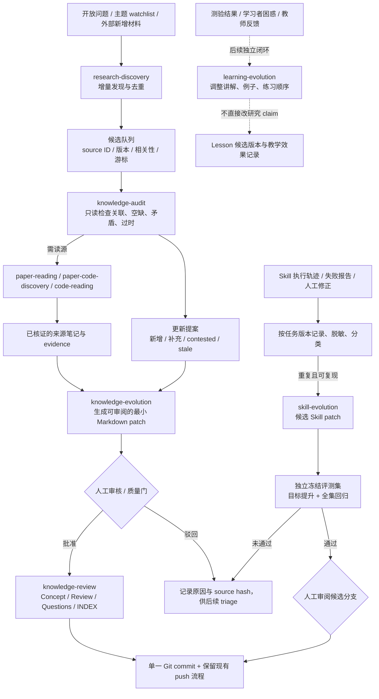

# Self-Evolving Research Knowledge Base：专题调研与架构设计

- 调研日期：2026-11-24
- 范围：Knowledge Evolution、Learning Evolution、Skill Evolution
- 方法：固定 Git commit 的公开源码静态阅读、论文页面检索、本地知识库目录审计；未运行第三方代码或安装依赖。

## 摘要

自迭代知识库不是一个会自行改写 Markdown 的 Agent，而是一组分开的闭环：发现候选、核对证据、提出有版本记录的修改、用独立评估验证、由人或受控门禁批准。三种进化必须分开：新研究证据更新研究知识；学习者表现更新教学路径；Agent 任务失败改进 Skill。它们的数据来源、评价指标和写入权限不同，不能用一个“evolve”动作替代。

当前知识库已经有相当成熟的阅读、源码发现、源码阅读、批次编排和跨论文 Review 流程。主要缺口是自动发现与增量游标、claim 级证据/冲突状态、只读审计和 Skill 的独立回归集。最小实施顺序是先加只读的 `research-discovery` 与 `knowledge-audit`，再加只生成候选补丁的 `knowledge-evolution`；在有固定评测集和重复失败样本后，才启用 `skill-evolution`。先人工触发，稳定后再安排周期任务。

本次会话没有可用的 GitHub MCP 工具。遵循现有 `paper-code-discovery` 与 `code-reading` Skills 的只读要求，改用 GitHub 公开页面、固定 SHA 的只读 checkout 和 arXiv 页面。`research-wiki` 的 commit 由 `git ls-remote` 固定，源码通过 GitHub raw 页面读取。Karpathy Gist 可直接读取。所有仓库只做静态检查，没有执行其脚本、测试、安装依赖或修改现有 Skills。

## 1. 开源项目技术对比

以下版本均指本次实际阅读的固定版本；源码路径链接固定到该 SHA，避免将滚动分支上的当前实现与本次观察混淆。

| 项目 | 主要机制 | 演化触发与写入方式 | 验证/风险控制 | 可借鉴点与边界 |
| --- | --- | --- | --- | --- |
| [Karpathy LLM Wiki Gist](https://gist.github.com/karpathy/442a6bf555914893e9891c11519de94f#file-llm-wiki-md) | 提出 raw sources、持久化 Markdown wiki、schema 三层；操作为 ingest、query、周期 lint，`index.md` 是内容目录，`log.md` 是 append-only 时间线。 | 新源或问题触发 LLM 把信息编入互链 wiki；人负责选源、探索和审阅。 | 文档是设计思想，不是可运行实现；没有正式 claim schema、自动批准规则或回归评测。 | 适合做知识库维护的原则和最小文档工作流；它把“LLM 可以改很多文件”当成便利，不能直接作为无人审核的写入策略。 |
| [llm-wiki-agent](https://github.com/SamurAIGPT/llm-wiki-agent/tree/86ab47d7cfe3b41e604df6bf19afbd9a911b9068) | `tools/ingest.py` 读取源、索引、概览和最近五个来源页；请求 LLM 返回 source/entity/concept 页面、overview、index、矛盾描述和 log，再写入 Markdown；随后检查断链和未入索引页。`refresh.py` 以原文 hash 识别本地源变化；`lint.py` 用 LLM 找孤页、矛盾和知识缺口；`health.py` 做低成本结构检查。 | 手动 ingest 新文档；refresh 只检查已登记本地原文变化，不发现互联网新论文。lint 按需运行，README 建议每约 10–15 次 ingest 做一次。 | 有 `--dry-run`、source hash 和 lint/health 分层；但 ingest 对多页直接写入，矛盾主要是自然语言提示，LLM context 仅含有限页面，没有 claim 级来源链或原子化审批。 | 借鉴“结构检查常跑、语义检查低频”“源 hash 跳过无变化”；将新候选与正式知识写入拆开。见 [`ingest.py`](https://github.com/SamurAIGPT/llm-wiki-agent/blob/86ab47d7cfe3b41e604df6bf19afbd9a911b9068/tools/ingest.py)、[`refresh.py`](https://github.com/SamurAIGPT/llm-wiki-agent/blob/86ab47d7cfe3b41e604df6bf19afbd9a911b9068/tools/refresh.py)、[`lint.py`](https://github.com/SamurAIGPT/llm-wiki-agent/blob/86ab47d7cfe3b41e604df6bf19afbd9a911b9068/tools/lint.py)。 |
| [research-wiki](https://github.com/johapark/research-wiki/tree/5551ee0e24eb72f7d45ede2947209b5d9cd2999c) | 以 claim 为单位组织论文和综合页：提取 paper claims、建引用/语义图、生成 synthesis 草案、按 claim fidelity、salience、coverage、coherence 等评分；支持 LLM critic 和版本化 batch checkpoint。新论文可产生邻接 synthesis 页的 proposal。 | 新论文导入后先生成 proposal；默认要人工审核才应用到已有综合页，不静默改写。 | 文档描述质量门、漂移限制、checkpoint source/config/code 指纹；单文件 ingest 可恢复。系统依赖 PDF 解析、embedding/reranker 和多轮 LLM，成本、复杂度高；当前主用途是研究 wiki。 | 最接近研究知识演化的实现。重点借鉴 claim 级溯源、综合页更新候选、promotion gate；不要在 MVP 复刻整套向量检索、tournament 或模型评分流水线。见固定版本 [`WORKFLOW.md`](https://github.com/johapark/research-wiki/blob/5551ee0e24eb72f7d45ede2947209b5d9cd2999c/WORKFLOW.md#L203)。 |
| [OpenWiki](https://github.com/langchain-ai/openwiki/tree/dcb803e9634e3d5d7361404aa4f7ee92a3e8e5ad) | 针对代码库事实做 versioned Claims。`repo://` evidence 带路径/行范围/hash；source snapshot 和每页 manifest 指纹化。预检能识别证据缺失、移动、过时或歧义；更新 planner 要对 stale/unresolved claim 明确确认、更新或撤回。 | 源文件 snapshot 改变时，生成受影响页面的任务；恢复运行会核对 snapshot/manifest。 | Claim 必须有 evidence；先规划再更新；页面和 Claims 写完才标记 manifest 完成；源中途改变则重规划。另有 connector ingestion 的 launchd scheduler，但不等同于定期重建整个 wiki。 | 借鉴证据位置、hash、stale 状态与任务计划；论文来源需换成 arXiv/DOI/版本/页节表图，不能直接照搬 `repo://`。见 [`preflight.ts`](https://github.com/langchain-ai/openwiki/blob/dcb803e9634e3d5d7361404aa4f7ee92a3e8e5ad/src/claims/brains/code/preflight.ts)、[`resolver.ts`](https://github.com/langchain-ai/openwiki/blob/dcb803e9634e3d5d7361404aa4f7ee92a3e8e5ad/src/claims/evidence/repository/resolver.ts)、[`page-jobs.ts`](https://github.com/langchain-ai/openwiki/blob/dcb803e9634e3d5d7361404aa4f7ee92a3e8e5ad/src/generation/page-jobs.ts)。 |
| [research-literature-workflow](https://github.com/guangsenaxel/research-literature-workflow/tree/b312bf79ac18cb16fec0c41612422d0bfc96956d) | 面向 Zotero/PDF 的维护工作流。只读 inspect 会找缺失元数据、文件变化、重复项和手工移动；metadata 搜索有上限；cache key 包含论文身份、PDF hash、parser/config 版本。 | `maintenance.py` 生成 findings/observations，不自动应用；`SafeWriter` 默认 create-only，更新需用户批准 plan，批准 hash 绑定计划和修改前内容。 | 保存用户分析，限制可管理字段，明确不自动删除或覆盖；有备份/锁/恢复路径，旧笔记冲突时保留现状。 | 强烈借鉴只读诊断、审批计划 hash、用户内容保护、来源 hash cache。缺少跨 Concept claim 图和外部新知发现。见 [`maintenance.py`](https://github.com/guangsenaxel/research-literature-workflow/blob/b312bf79ac18cb16fec0c41612422d0bfc96956d/scripts/research_os/maintenance.py)、[`writer.py`](https://github.com/guangsenaxel/research-literature-workflow/blob/b312bf79ac18cb16fec0c41612422d0bfc96956d/scripts/research_os/writer.py)、[`safety.md`](https://github.com/guangsenaxel/research-literature-workflow/blob/b312bf79ac18cb16fec0c41612422d0bfc96956d/docs/safety.md)。 |
| [A-Mem](https://github.com/agiresearch/A-mem/tree/ceffb860f0712bbae97b184d440df62bc910ca8d) | `MemoryNote` 保存内容、context、keywords、tags、links、时间和 evolution_history；加入新 note 时检索语义近邻，LLM 判断是否加强连接或更新邻居的 context/tags。 | 单条记忆到达时在线处理；默认每 100 次 evolution label 触发 `consolidate_memories()`，该代码路径主要是重置并重建向量索引。 | 近邻让新记忆与旧记忆相关联，但没有论文 claim 的来源、矛盾/过时状态或独立事实核验。源码初始化时还尝试 reset Chroma collection，实际使用需另审持久化边界。 | 可借鉴“按相似近邻连接”作为建议生成，不要把语义相似当作支持关系或事实证据。用户指定仓库与 A-Mem 论文最新版本中的生产代码链接存在版本/仓库对应差异：引用论文机制时以论文为准，源码结论仅限本仓库 SHA。见 [`memory_system.py`](https://github.com/agiresearch/A-mem/blob/ceffb860f0712bbae97b184d440df62bc910ca8d/agentic_memory/memory_system.py)。 |
| [SkillOpt](https://github.com/microsoft/SkillOpt/tree/dc0b5e654cafa1073a2819086151c1e0d13012f0) | 从 rollout 的成功/失败轨迹提出对 Skill 文档的受限 patch；可聚合 minibatch、多轮 patch、epoch 慢更新和拒绝编辑缓冲。 | 候选 Skill 用 selection/validation 集合评分，门控函数只在候选分数严格高于当前分数时接受；保留 best skill 和步骤记录。 | 将优化器与运行模型分开；保留回滚到 best；有硬/软/混合指标。但实际是否独立取决于数据划分、配置和评测集是否被反复调参污染。 | 借鉴受限 patch、拒绝原因记录、候选与当前版比较、慢更新与快速更新分层。应用时需另设冻结 holdout，且不得只优化单一 aggregate score。见 [`trainer.py`](https://github.com/microsoft/SkillOpt/blob/dc0b5e654cafa1073a2819086151c1e0d13012f0/skillopt/engine/trainer.py)、[`gate.py`](https://github.com/microsoft/SkillOpt/blob/dc0b5e654cafa1073a2819086151c1e0d13012f0/skillopt/evaluation/gate.py)。 |
| [SkillHone](https://github.com/Tencent/SkillHone/tree/773d54d11aaa6c00d45720e2e501b6d8bfa8f590) | 把能力问题变成 Issue，每个 Issue 至少链接一个复现测试；保存 Run、失败类别、版本、PR 和 wiki 审计轨迹；benchmark workflow 从 probe 失败推动修复。 | 修复在独立分支和隔离 clone 中进行；有最大迭代/耐心参数、最小改进阈值；通过后生成本地 PR，默认人工 review；可配置本地自动 merge，但不 push。 | `probe/pr_val/test` 数据集在独立仓库冻结 commit/hash；修复 agent 不可读取 held-out 数据、答案或 verifier；host 再运行链接测试。验证集回归超过 2% 会拒绝候选。 | 是执行失败到 Skill 改进的端到端审计案例。借鉴 Issue+复现测试、分支隔离、独立评测和不自动 push；其 host/runtime 较复杂，适合后期参考，不是本地 KB MVP。见 [`benchmark.ts`](https://github.com/Tencent/SkillHone/blob/773d54d11aaa6c00d45720e2e501b6d8bfa8f590/src/core/benchmark.ts)、[`cli.ts`](https://github.com/Tencent/SkillHone/blob/773d54d11aaa6c00d45720e2e501b6d8bfa8f590/src/cli.ts)。 |

### 对比结论

这些项目不是同一种“自演化系统”。Karpathy 与 llm-wiki-agent 描述/实现 wiki 编纂；research-wiki 与 OpenWiki 强调 claims 和 evidence；research-literature-workflow 强调安全写入；A-Mem 关注可检索记忆关联；SkillOpt 与 SkillHone 关注通过任务结果改能力。最值得组合的是：research-wiki 的 claim 候选与质量门、OpenWiki 的 source fingerprint/stale 判定、literature-workflow 的审批计划与内容保护、SkillHone 的隔离测试门，以及 Karpathy 的 Markdown/Git/索引低依赖形态。

## 2. 代表论文与源码机制分析

### 2.1 Knowledge Evolution：从相似关联走向证据更新

- **A-MEM**：论文以 Zettelkasten 为启发，为记忆添加 context、keywords、tags 等属性，检索语义近邻后由 LLM 建立链接并演化邻居表示。机制解决“新记忆如何连旧记忆”，并不等于研究命题的证据管理。论文报告的更新机制和本次指定 `agiresearch/A-mem` 源码不能无条件视为同一发行物；当前论文页面的后续代码链接指向其他 A-Mem 工程。报告因此分别标记论文机制与仓库实现。论文：[A-MEM: Agentic Memory for LLM Agents](https://arxiv.org/abs/2502.12110)。
- **Karpathy 的 LLM Wiki**：是 idea file，不是系统论文或实现规范。核心是把原始材料编译为可链接的持久知识，并通过 lint 发现过时、矛盾、孤立页和数据缺口；索引与 append-only log 让维护过程可导航、可追踪。它适合启发目录结构，不提供可量化质量门。[Gist 原文](https://gist.github.com/karpathy/442a6bf555914893e9891c11519de94f#file-llm-wiki-md)。
- **research-wiki / OpenWiki**：二者的关键改进是把“某页需要更新”下沉到有来源的 claim。前者对论文 claim 做 fidelity/coverage/fitness 检查并生成需审核的 synthesis proposal；后者保存可重新定位的 evidence range/hash，并在证据变化时令 claim 进入 stale/unresolved 状态。这样才可以把“新旧观点不一致”变成可审核对象，而非让 LLM 重写段落后丢掉历史。

### 2.2 Learning Evolution：反馈应更新教学决策

清单中的项目没有一个直接解决“依据学习者的误解/测验结果持续改写课程内容”这个完整问题。现有 [learning-batch](../../skills/learning-batch/SKILL.md) 是论文批次编排器，[lessons](../../lessons/agent-llm/lesson-02-advanced-agent-systems.md) 是教学材料；本地没有发现 learner profile、答题表现、教学干预版本和学习收益的闭环。

相邻论文给出可参考边界：

- **LearnLens** 把错误诊断、课程概念链检索和教师审核放在一起；教师可定制问题、检查/修改反馈，并用 verifier 看事实准确性、课程相关度和表达清晰度。其目标是生成课程对齐的反馈，不是让系统自动改写研究知识库。[论文](https://arxiv.org/abs/2507.04295)。
- **EduLoop-Agent** 将知识点掌握诊断、下一题推荐和 LLM 学习反馈组成 Diagnosis–Recommendation–Feedback 闭环；论文也指出验证主要依赖单一公开数据与离线模拟，课堂学习增益和外部有效性仍待研究。[论文](https://arxiv.org/abs/2510.22559)。

因此，学习反馈只应产生教学建议，例如增加先修讲解、改换例子、调整练习顺序；若反馈中出现一个新事实，应转回 Knowledge Evolution 的来源验证流程。学习者信号不能直接证明学术命题正确。

### 2.3 Skill Evolution：轨迹不是经验，经过验证的修复才是

- **Reflexion** 是知识库已有论文。它用 task evaluator 的反馈生成 verbal reflection，放入后续 attempt 的有限 episodic memory。它展示“失败反馈可以改变下一次执行”，但没有证明如何持久维护跨任务 Skill、管理冲突经验或阻止能力回退。见本地 [Reflexion 笔记](../../papers/reflexion/notes.md)。
- **SkillOpt** 将成功与失败 rollout 汇总为候选文本编辑，独立 optimizer 做受限修改，由 validation gate 比较候选/current/best。其拒绝编辑缓冲和慢更新机制使“被拒绝的经验”可以反馈给后续优化，而不直接污染已接受版本。论文：[SkillOpt](https://arxiv.org/abs/2605.23904)。
- **SkillHone** 把失败转为带复现测试的 Issue，并在隔离分支修复；probe 可供优化者定位错误类型，但 held-out `pr_val/test`、答案和 verifier 不向修复者开放，候选经 host 再跑测试后才形成 PR。论文：[SkillHone](https://arxiv.org/abs/2606.08671)。它比“让模型总结失败经验”多了独立测试、隔离执行和可回滚版本。

本地方案应把一次失败保存在失败记录中，不立即改 Skill。只有重复、可归因、可复现的失败模式才能提出通用修改；修复还要通过既有能力回归集和目标能力提升门槛。

## 3. 现有知识库能力审计

### 已有基础

- **研究规模与导航**：本次目录计数为 27 个 `concepts/*.md`、59 个 `papers/**/notes.md`、21 个各主题 review 文档、11 个 `skills/**/SKILL.md`。`INDEX.md` 已连接核心 Concept、论文、Reviews、33 篇 TSAD 精读成果和结构化导出。
- **Concept 更新约定**：[`concepts/README.md`](../../concepts/README.md) 已要求每次阅读检查新 Concept、更新旧 Concept、关联、矛盾和新问题；Concept 说明文件标记 `Status: evolving`。这是有效的人工协议，但没有自动触发器或稳定 claim id。
- **证据阅读**：`paper-reading` 有 paper note 模板、来源定位和 source-grounding 检查；`paper-code-discovery` 固定仓库身份/commit；`code-reading` 要求只读静态分析、路径级映射和限制说明。
- **跨论文沉淀**：[`knowledge-review`](../../skills/knowledge-review/SKILL.md) 维护版本化 Review、Concept 边界、问题状态、INDEX 和 learning log，明确保留历史，不在无源时扩展调查。
- **问题与复盘**：[`notes/questions.md`](../questions.md) 有 open/partial/answered 状态和来源线索；[`notes/learning-log.md`](../learning-log.md) 有学习里程碑和下步主题。二者是人工知识流程的素材。
- **版本同步**：现有 Skills 约定完成且通过检查后创建 Git commit 并 push `origin/main`，不 force-push；Git 历史可作为文档级审计及回滚基础。

### 缺口与风险

1. **没有主动 discovery 游标**：Reviews 明确默认不自行搜新材料；未发现统一的关键词/watchlist、上次查询时间、DOI/arXiv/repo 去重和候选队列。
2. **没有结构化主张级 provenance**：纸面笔记一般有来源链接/章节定位，但 Concept 中的综合主张没有一致的 `claim_id → source revision → locator → relation/status` 记录；不能低成本识别某条综合结论被哪版材料推翻。
3. **矛盾/过时检查依赖人工**：`concepts/README.md`、`notes/questions.md` 提醒检查矛盾和问题，但缺少 `contested/stale/superseded` 状态、触发器和待审核报告。
4. **缺少自动审计层**：没有知识库专用的便宜结构 lint、增量语义 audit、结构化 evidence coverage 报告或变更候选 PR 流程。
5. **Learning Evolution 缺信号和结果**：Lessons 和 learning log 记录教学内容/阅读进度，不记录学习者答题、误解类别、教学修订版本和效果，因此目前不能声称存在课程自适应闭环。
6. **Skill Evolution 缺独立评估**：现有 Skills 有质量流程和个别已验证标记，但仓库未发现分离保存的固定 Skill 回归/盲测集、失败聚类记录、候选基线分数和能力回退报告。`concepts/skill.md` 也仍是初步定义。
7. **未见周期调度配置**：本仓库未发现 GitHub Actions/cron 一类任务编排；现有 git commit/push 约定是写入同步规则，不是定时 discovery/audit。

## 4. 推荐架构与流程

### 设计原则

1. 先增量发现候选，再按相关性和证据质量决定是否阅读；“搜到”不等于“值得更新”。
2. 每条可演化知识应保留“谁说的、在哪一版、证据在何处、和现结论是什么关系”。
3. Audit 默认只读，Evolution 先输出补丁；审批后才写入正式 Concept、Review、Lesson 或 Skill。
4. 失败、学习反馈、论文证据是三种记录类型，不在同一层相互代替。
5. Git 提供版本与撤销；结构性 lint 用确定性检查，语义判断才用 LLM。

### 流程图



自动周期任务只负责形成 discovery/audit 候选报告；对正式知识的改动走审批。现有人工完成后的 Git 自动同步仍适用；系统生成的未审补丁不得直接推送到 `main`。

## 5. Skill 职责、输入输出与协作关系

| Skill | 输入 | 输出 | 读写边界 | 协作关系 |
| --- | --- | --- | --- | --- |
| `research-discovery` | 主题/question watchlist、source type、上次 cursor、排除项、时间范围 | 带稳定 ID 的候选清单、重复项、发布/版本变更、查询日志和新 cursor | 读公开元数据；写入候选 inbox/状态文件；不写论文结论或 Concept | 交给 `knowledge-audit` 做关联和价值判断；高分候选再调用现有 `paper-reading` 或 `paper-code-discovery`。 |
| `knowledge-audit` | 候选来源、目标 Concept/Review/Question 范围、上次 audit hash | 只读报告：潜在新增、重复、来源缺口、矛盾双方、stale claims、孤立/缺链、优先级和依据 | 默认只读；不编辑核心知识、不关闭问题、不替人消解冲突 | 调用/推荐现有 paper-reading、code-reading 或 knowledge-review；把有证据的 proposal 交给 `knowledge-evolution`。 |
| `knowledge-evolution` | 已核证源笔记、audit proposal、人批准的范围、相关 Concept 和 Review | 最小 diff；每项改动附来源/locator/关系/状态；未决问题更新草案；变更摘要 | 初期只生成 patch/工作树草稿；审批后才能应用；不删除历史 Review 或证据 | 复用 `knowledge-review` 的边界和术语规则，完结后由现有 git 同步规范提交推送。 |
| `skill-evolution` | 失败/成功轨迹、失败签名、当前 Skill SHA、相关修订历史、目标及冻结测试说明 | 失败归因、可迁移规则、候选 diff、测试报告、评分变化、未通过项、回滚 commit | 不在被测运行中改 Skill；只写独立分支；不得读盲测答案或修改评测程序 | 轨迹先由 host/执行器记录，人工确认复现测试后进优化；候选通过门禁再审阅并合并。 |

四者的最小依赖链是 `research-discovery → knowledge-audit → knowledge-evolution`；失败反馈进入独立的 `skill-evolution`。Learning Evolution 暂不作为第五个新 Skill，而是等到有 learner signal 和 outcome 指标后独立设计，以免将用户的研究学习日志误当作学生模型。

## 6. 知识更新、证据管理与冲突处理

### 如何发现、筛选和关联新知识

**主动发现来源**应由一组明确的研究问题驱动：`notes/questions.md` 中状态为 Open/Partially Answered 的问题、Concept 的 `Open Questions`、用户 watchlist，以及已读论文的引用/被引链。对于论文，可查 arXiv/Crossref/Semantic Scholar 等元数据；代码可查询已确认项目的 release/commit。Discovery 以 cursor 做时间增量，不每次重跑全网搜索。

先做确定性去重，再做相关性排序：优先 DOI、arXiv ID+version、固定 Git SHA、官方 repo URL；其次用标题规范化和内容 hash。候选优先级可由透明分项组成：`topic match + open-question match + source authority + methodological novelty + evidence strength + update urgency`。模型只解释分项和推荐，不把不透明总分直接当批准。

**值得更新的触发条件**包括：

- 开放问题有高质量的新证据；
- 新论文改变方法边界、主张适用范围、基准或结论；
- 官方代码/论文新版本改变实现或关键参数；
- 新源与当前主张冲突、限制了当前结论，或可合并重复记录；
- 已引用来源撤回/更正、版本失效，或长期未检查且为核心结论。

纯重复、只有标题变化、与主题无关或证据不足的材料只记候选/忽略原因，不触发 Concept 重写。

### 最小证据记录格式

短期不必引入数据库。先在来源笔记或演化提案中采用统一字段；当跨文件 claims 数量使 Markdown 难以查询时，再迁移到 JSONL/SQLite。

```yaml
claim_id: memory.semantic-linking.001
claim: 新记忆通过语义近邻和显式链接连接到已有记忆
claim_type: paper_fact # paper_fact | cross_source_synthesis | interpretation | learner_signal | execution_observation
status: active # active | contested | needs_review | superseded | retracted
scope: long-term note association; not evidence validation
source_id: arxiv:2502.12110v11
source_uri: https://arxiv.org/abs/2502.12110
source_version_or_sha: 2502.12110v11
locator: Sec. 3, Fig. 2
accessed_at: 2026-11-24
source_hash: sha256:...
relation: supports # supports | qualifies | contradicts | supersedes | related_to
related_claims: [memory.semantic-linking.002]
```

记录原则：

- 论文事实标注 section/table/figure/appendix/page；源码事实标注 repo SHA、文件和 symbol/行；网页记录访问日期与页面版本/内容 hash（可得时）。
- 把原文事实、跨来源综合、个人解释、学习者反馈、执行观察分开；不要把模型 confidence 伪装成证据质量。
- 新主张先挂到具体 paper note；Concept 是跨来源综合，指向 claim/source，不复制整篇论文摘要。Review 保留历史版本，Question 记录仍未解决的分歧。
- 新旧主张通过语义关系连接，而不是只按向量相似度归并。相似关系不等于互相支持。

### 旧结论、冲突和过时处理

1. **不覆盖历史**：新增证据在 paper note/claim ledger 留新版本；Concept 当前视图可以更新，但要指向被替代的 claim 和新 evidence。历史 Review、问题来源及 Git commit 不删除。
2. **先定 scope 再判矛盾**：比对术语定义、任务、数据集、时间范围、假设、方法版本和评价指标。两个结论可能一个适用基准 A、另一个适用基准 B，不应被压成真假二选一。
3. **冲突未决时显式 `contested`**：保留双方来源、scope 和关键差异；新建/保留 Question，知识审计报告中列出“谁冲突、证据在哪里、还缺什么”。不能让 LLM 为了文风统一而自行调和。
4. **按证据类型解决**：优先原始论文/官方勘误/作者仓库固定版本，后用二手总结；新日期不自动代表更可信。若 source 被撤稿，标记 `retracted` 并检查所有指向它的 claims。
5. **旧结论不一定删除**：已被新证据替代时标记 `superseded`，说明替代时间和关系；只因暂时没被重复验证则标记 `needs_review`，不能误写为错误。

## 7. Skill 版本、独立评估与回滚

Skill 是可维护文本资产，接受版本化，但要同时版本化它的使用条件与评估证据。建议每次 Skill 变更记录：Skill Git SHA、模型/runtime/tool 版本、任务类型、失败签名、改动假设、变更 diff、评测集版本、基线/候选结果、审批人与回滚目标。

### 从失败中提取可复用经验

1. 执行结束后记录任务类别、结果、错误类别、Skill SHA、关键工具结果、人工修正和是否复现；保存前对敏感输入脱敏。
2. 将“偶发失败”“环境故障”“来源/检索错误”“策略缺陷”“评测错误”分类，先排除 rate limit、网络故障等非 Skill 问题。
3. 只有同一失败签名在至少 3 个独立任务/不同样本重复，或有一个高影响且可稳定复现的故障时，才生成候选修复。分析成功轨迹，避免删除已验证的快速路径。
4. 将经验写成可执行指令或测试条件，例如“遇到版本变动，先 pin SHA 再比较”，不要写成依赖任务专名的记忆。

### 防止能力退化的门禁

- 为每个高价值 Skill 建隔离的 `skill-evals/<skill>/` 集合，至少分开发/选择集和冻结 holdout；测试内容、gold 和 evaluator 权限不交给修复 Agent。评测数据不要与候选生成材料共用。
- 回归集覆盖常见路径、边界条件、失败恢复、资源限制和历史 bug。添加 case 需在候选之外审阅，避免 optimizer 反复针对公开题目过拟合。
- 先跑基线，再跑候选；候选需达到目标任务提升阈值，且所有关键能力没有超过容忍回退。可把多指标做分任务报告，不只看一个平均分。
- 每次只接受小 patch；先 candidate branch/draft PR，跑静态规则和独立评估，再由人审阅。每一版保持可直接 checkout 的 Git commit；拒绝结果也记录原因，避免重复试错。
- 若合并后线上/后续回放指标下降，立即 revert 到上一个 accepted commit；不能让修复 Agent 自己扩大改动范围掩盖回退。

MVP 评测门槛可先设为：目标任务集至少提升 5 个百分点；任何高优先级回归集下降不得超过 2 个百分点；关键错误/安全 case 不能新增失败；holdout 只用于最终候选检查，失败后需要新版本候选和新一轮人工批准。样本不足时结果记 `inconclusive`，不自动合并。

## 8. 周期调度、Token 与执行成本

### 调度建议

| 任务 | 初始触发 | 允许自动做的事 | 不自动做的事 |
| --- | --- | --- | --- |
| Discovery | 人工运行；稳定后每周一次 | 查元数据 delta、去重、形成候选报告和 cursor | 自动下载/精读大量全文，改写 Concept，提交主分支 |
| Knowledge audit | 每月一次，或发现新候选/重要新源后运行 | hash 比较、链接与索引结构检查、限定范围语义审计 | 自动关闭问题、裁决冲突、重写综合页 |
| Knowledge evolution | 用户批准某个 proposal 时触发 | 生成 scoped diff、链接检查、差异摘要 | 未审补丁直接写入/推送 `main` |
| Skill evaluation | 任务量达到阈值或重复失败时触发 | 记录失败类、跑冻结回归集、生成候选结果 | 每次失败都改 Skill；让候选生成器访问 holdout |
| Learning review | 学习者主动反馈或完成一个练习批次后 | 汇总困惑点和错误类别、提出 Lesson 变更 | 把成绩直接变成研究事实，或无教师/用户确认改课程主干 |

本轮不创建或启用任何 scheduler。等手动流程连续数次通过验收后，再选择运行环境支持的 cron/GitHub Actions/local scheduler；调度器只运行 discovery/audit 候选生成。保留知识库既有“校验成功后 commit + push `origin/main`”约定，但自动周期任务的候选先走审阅分支/PR，获批后按现有同步方式合并。

### Token 与成本控制

- **元数据先行**：标题、作者、摘要、时间、DOI、版本和 repo SHA 先做筛选；不要为每个搜索结果请求全文摘要。
- **增量和 hash**：保存查询 cursor、来源 ID、source hash、解析器版本、prompt 版本和模型名称；同一版本不重复分析。源版本变更才触发重新审查。
- **先确定性、后语义**：先检查 Markdown links、INDEX 覆盖、frontmatter、空页和 hash；只有结构检查命中的文件或高优先级候选才使用 LLM。
- **检索限上下文**：从 INDEX、显式 links 和相似 Concept 选少量相关片段；每次初始最多读取 5 个邻接笔记/10 条 claims，必要时再扩展。不要把整个 59 篇论文目录塞入 prompt。
- **设硬预算**（作为起始配置，按日志校准）：每周 discovery 不超过 20 个 metadata candidates、5 个全文深读候选；一次 audit 不超过 10 个目标页；一次 evolution 最多 3 个文件/5 条 claims；Skill candidate 最多 3 轮 patch、每轮 10–20 个固定回归 case。每项单独配置 input/output token cap，触顶则输出部分结果并暂停，不自动放宽预算。
- **缓存与模型分层**：本地确定性规则处理去重和路径检查；小模型/低成本模型只做候选分类；高能力模型用于矛盾说明和 patch 草稿；人工核对决定 promotion。可缓存 embedding/模型结果，但缓存键需包含完整输入 hash、模型和 prompt 版本。
- **记录成本**：每次写 run manifest，包括候选数、全文数、prompt/completion token、模型、缓存命中、墙钟时长、API 成本（若工具可返回）、变更文件数、拒绝数。用近 4 周 P50/P95 调整预算，不用无限重试。

## 9. 分阶段实施计划

| 阶段 | 内容 | 完成条件 | 风险边界 |
| --- | --- | --- | --- |
| 0. 设计基线 | 本报告；不改现有 Skills、不加 scheduler。 | 方案和验收条件可评审。 | 本次调研范围内完成。 |
| 1. 候选发现 | 新增 `research-discovery` Skill；维护明确主题、数据源、query、cursor 和候选格式；先人工触发。 | 同一批次稳定 ID 去重，记录来源/版本/访问时间/cursor；输出候选而不改知识页。 | 不全库搜索、不自动精读。 |
| 2. 只读审计 | 新增 `knowledge-audit`；先确定性链接/INDEX/frontmatter/hash 检查，再对小范围 Concept、Question 和 Review 做语义检查。 | 可报告 evidence gap、冲突、stale、重复和孤立项；检查结果可追溯；不写源文件。 | 模型只建议，不做冲突裁决。 |
| 3. 提案式知识更新 | 新增 `knowledge-evolution`，从已核证 paper/code note 生成最小 patch；建立 evidence/status/relationship 字段。 | 用户批准后才应用；保留老 claim、Review 和 Git 历史；每个 claim 能追至 source SHA/version+locator。 | 不批量重构目录，不自动改写 Skills/Lessons。 |
| 4. Skill Evolution | 在独立目录先建立每个重点 Skill 的固定 baseline case；增加脱敏 failure record 和失败签名；实现 candidate branch 与评测 gate。 | 有目标提升、回归报告、审阅 diff、回滚演练；只对重复或高影响复现错误提案。 | 评测集与生成器分离；没有独立 holdout 不合并。 |
| 5. 周期调度 | 手动流程连续稳定后，周期运行 discovery 与 audit；输出报告/PR，不自动 merge。 | 有 run log、失败恢复、预算监控和重复任务幂等性；无重复 commit/重复 LLM 费用。 | 本次不启用。 |
| 6. Learning Evolution | 单独采集答题/困惑/教师反馈及 Lesson 版本、结果；先从建议和教师审核开始。 | 能区分“内容正确性”与“教学效果”；变化前后有可比较学习指标且保护隐私。 | 不从一般聊天推断学习者缺陷；不直接改事实依据。 |

建议一次只给一个小专题试点，例如 `concepts/memory.md` 与其引用的 Reflexion/A-Mem notes，或 `concepts/skill.md` 与 2–3 个 Skill。试点便于建立 gold audit case 和检查 false positive，不需要先引入新向量库、服务端或知识图谱数据库。

## 10. 最小可行版本与验收条件

### MVP 范围

MVP 只包含：

1. `research-discovery`：人工输入主题/开放问题，读取增量元数据，按 DOI/arXiv/repo SHA 去重，写候选报告和 cursor。
2. `knowledge-audit`：对候选及最多 10 个相关页面做只读 audit，检查重复、缺引用、关系缺失、潜在矛盾、stale source、open question 和缺口。
3. `knowledge-evolution`：只接收已有来源笔记和明确 proposal，生成不超过 3 个文件的候选 patch；主张附证据 locator、source version/hash 和关系状态。
4. `skill-evolution` 暂只定义记录 schema 和人工候选审阅流程；在固定评测集建立前不自动改写 Skill。

不引入向量数据库、不装服务、不自动处理任意网站、不新增周期任务、不改现有 Skills。Markdown、INDEX、Questions、Reviews 与 Git 继续做主要存储和版本边界。

### 验收清单

- Discovery 同一输入重复运行时不会重复入队；报告包含 query、时间范围、stable source ID、source revision、访问日期、去重原因和 cursor。
- 用至少 10 个已知案例人工标注 audit 结果，包括重复材料、无来源主张、两条真实冲突、仅适用范围不同的“假冲突”、过时版本和缺失 cross-link。所有标成 high-impact 的案例都能指出源文件/locator；不确定项必须标 `needs_review`，不得声称自动判定正确。
- Discovery、audit 和 patch 生成未获批准时不改变 `papers/`、`concepts/`、`notes/reviews/`、`notes/questions.md`、`INDEX.md`、`lessons/`、`skills/` 中的正式内容。
- 每个候选 patch 限定路径和文件数，给出 before/after、主张关系、证据链接、未决问题和回滚方法；不存在没有 source citation 的事实性新增。
- 审批后能在一个可审阅 Git commit 中应用；可用 `git revert` 回到原文；历史 Review/Question/来源记录不被删除。
- Skill Evolution 开始自动生成候选前，至少已有 20 个冻结的代表性任务样本（覆盖成功/失败/边界）和单独 holdout；否则仅做人工复盘。候选须达到第 7 节提升/回退门槛，且不能读取评测金标。
- 每次运行记录模型/prompt/hash/cursor、token 和候选/写入数；预算上限触发后安全停止。周期任务只在后续阶段经单独批准后启用。

### 推荐的实现顺序

先实现 discovery 和只读 audit，验证“发现有价值、审计能指对证据”；随后让 evolution 产出人工审阅补丁。经过这三步并积累失败记录后，再建设独立 Skill 评测集和 Skill Evolution。这个顺序在保留当前 Markdown/Git 工作方式的同时，把最容易造成错误积累的自动写入放到最后。

## 参考来源

### 项目与源码版本

- [Karpathy LLM Wiki Gist](https://gist.github.com/karpathy/442a6bf555914893e9891c11519de94f#file-llm-wiki-md)
- [SamurAIGPT/llm-wiki-agent @ `86ab47d7cfe3b41e604df6bf19afbd9a911b9068`](https://github.com/SamurAIGPT/llm-wiki-agent/tree/86ab47d7cfe3b41e604df6bf19afbd9a911b9068)
- [johapark/research-wiki @ `5551ee0e24eb72f7d45ede2947209b5d9cd2999c`](https://github.com/johapark/research-wiki/tree/5551ee0e24eb72f7d45ede2947209b5d9cd2999c)
- [langchain-ai/openwiki @ `dcb803e9634e3d5d7361404aa4f7ee92a3e8e5ad`](https://github.com/langchain-ai/openwiki/tree/dcb803e9634e3d5d7361404aa4f7ee92a3e8e5ad)
- [guangsenaxel/research-literature-workflow @ `b312bf79ac18cb16fec0c41612422d0bfc96956d`](https://github.com/guangsenaxel/research-literature-workflow/tree/b312bf79ac18cb16fec0c41612422d0bfc96956d)
- [agiresearch/A-mem @ `ceffb860f0712bbae97b184d440df62bc910ca8d`](https://github.com/agiresearch/A-mem/tree/ceffb860f0712bbae97b184d440df62bc910ca8d)
- [microsoft/SkillOpt @ `dc0b5e654cafa1073a2819086151c1e0d13012f0`](https://github.com/microsoft/SkillOpt/tree/dc0b5e654cafa1073a2819086151c1e0d13012f0)
- [Tencent/SkillHone @ `773d54d11aaa6c00d45720e2e501b6d8bfa8f590`](https://github.com/Tencent/SkillHone/tree/773d54d11aaa6c00d45720e2e501b6d8bfa8f590)

### 论文

- [A-MEM: Agentic Memory for LLM Agents](https://arxiv.org/abs/2502.12110)
- [SkillOpt](https://arxiv.org/abs/2605.23904)
- [SkillHone](https://arxiv.org/abs/2606.08671)
- [LearnLens: LLM-Enabled Personalised, Curriculum-Grounded Feedback with Educators in the Loop](https://arxiv.org/abs/2507.04295)
- [A Closed-Loop Personalized Learning Agent Integrating Neural Cognitive Diagnosis, Bounded-Ability Adaptive Testing, and LLM-Driven Feedback](https://arxiv.org/abs/2510.22559)
