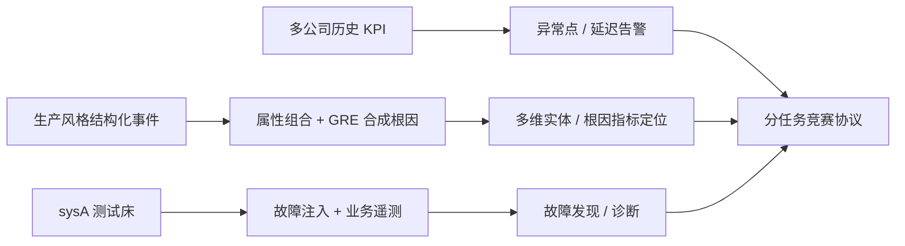

# Constructing Large-Scale Real-World Benchmark Datasets for AIOps

## 论文身份与材料

- **作者：** Li Zeyan, Han Jing, Zhao Nengwen, Zhang Shenglin, Sun Yongqian, Chen Pengfei, Wen Xidao, Ma Minghua, Pei Dan。
- **发表：** *ZTE Communications*, 2026, Vol. 24 No. 3, pp. 59–69；DOI [10.12142/ZTECOM.202603008](https://doi.org/10.12142/ZTECOM.202603008)，[期刊 PDF](https://www.zte.com.cn/content/dam/zte-site/res-www-zte-com-cn/mediares/magazine/publication/com_en/article/en202603/20260308.pdf)。
- **本地材料：** [论文 PDF](../../../sources/papers/benchmark/Constructing_Large_Scale_Real_World_Benchmark_Datasets_AIOps_ZTECOM_202603008.pdf) 及同目录提取文本。已阅读论文正文、表格与相关评估实现；数据集本身未下载、未运行注入。
- **论文链接的项目：** [KPI anomaly detection](https://github.com/netmanaiops/kpi-anomaly-detection)、[MultiDimension-Localization](https://github.com/NetManAIOps/MultiDimension-Localization)、[AIOps Challenge 2020 Data](https://github.com/NetManAIOps/AIOps-Challenge-2020-Data)、[iops evaluation](https://github.com/iopsai/iops/tree/master/evaluation)。评估代码静态快照 `ad962c2187d73b1a14971b255a2bd87212f896f2`；数据仓库快照 `5dcea9688794f3787a9b7e4a8931c6e70fa0ec78`。

## 1. 论文贡献：三种任务，三条数据谱系

标题中的“large-scale real-world”不表示单一数据集由同一采集/标注协议构成。论文回顾 AIOps Challenge 2018–2020 的三类基准：KPI 异常检测、结构化多维根因定位、注入式系统故障发现与诊断。它的主要价值是描述数据如何发布、形成竞赛任务和暴露复现困难；不能把三个集合合并成一个规模指标，也不能将竞赛成绩直接理解为同一 RCA 任务上的算法排名。

## 2. Dataset A：生产 KPI 异常检测

### 数据来源与范围

论文正文列出的公司来源为 **Sogou、eBay、Baidu、Tencent、Alibaba**。论文 Table 1 的初步公开版本报告 26 条 KPI 序列、4,821,526 个点、60–207 天；异常比例为 0.01%–4.37%，均值 0.96%。但正文另一处说数据由五家公司提供的“7 KPIs”并由资深工程师标注。论文没有把“7 个 KPI 类别/指标”和 Table 1 的 26 条 series 的映射说清楚，故需保留口径歧义，不能擅自将 7 与 26 解释为同一统计单位。（§3、Table 1）

论文使用真实公司监控序列，是自然运行数据而非统一故障注入。但不同公司对 KPI 定义、采样、标签及异常语义可能不同，原文没有给出足以统一这些机制的完整 schema。原文提到工程师标注异常与发布初版数据；公开材料仍需按对应数据版本核对。

### 延迟评价代码

2018 赛题最佳 F1 报告为 0.8216。公开 `iops/evaluation/evaluation.py` 的 `get_range_proba` 实现如下行为：对一段连续真实异常，只要预测在异常段开始的前 `delay+1` 个位置内至少命中一次，就把整段预测扩展为正例；否则清零该真实异常段。`reconstruct_label` 按 timestamp 排序，以最小间隔重建时间轴，缺失点补 0；最终把 KPI 结果拼接后计算全局 F1。

解释性例子：一个 20 点异常段，delay=7，预测只在段内第 5 个点报一次，评分预处理会把整段看作检出。这鼓励尽早告警并处理缺失时间点，但它不再区分段内持续覆盖、准确 onset 及告警是否覆盖完整影响期。该 evaluator 是 Dataset A 的历史赛题代码，不应拿来解释 Dataset B/C 的评分。

## 3. Dataset B：多维根因定位

### 结构化事件与任务

任务源于 Suning 生产交易数据。原始事件由多个 **attributes**（描述维度，如区域、ISP、商品类别）和 **measures**（聚合指标，如订单量/金额）组成。按时间窗对事件分组后，异常 measure 可定位到一组 root-cause attribute values。论文 Table 5 报告 400 个案例、5 个维度；与单一 KPI 异常检测不同，该任务同时要求找到异常实体组合和根因指标。

### 论文描述的合成流程

Dataset B 的真实交易数据提供业务分布基础，异常案例通过 Generalized Ripple Effect（GRE）机制生成。论文描述的构造过程可以按以下顺序理解：

1. 选取具有平滑历史行为的时间片，避免把已有波动误当作注入效果；
2. 从五个属性维度中挑选 1–4 个维度形成注入组合；
3. 选择 1–4 个属性值组合，作为已知根因组合；
4. 根据 GRE 改变目标聚合 measure，使异常影响沿设定属性组合展开；
5. 对被修改和未修改记录加入高斯噪声，保留自然波动外观；
6. 过滤几乎由同一批事件行构成、难以区分的其他属性组合，以及因噪声/变换意外异常的非目标 measure。

文中例子用电商交易记录说明：Timestamp、Amount、Region、ISP 等事件字段先聚合为监控 measure；如果某一地区订单金额下降，任务不只是检测曲线变化，还要定位导致异常的维度组合。400 个案例中，根因组合数 1/2/3/4 的案例数分别为 144/131/89/36；被选中属性维度数为 1/2/3/4 的案例数分别为 96/136/108/60。（§4，Tables 3–5）

这种方法比纯规则玩具数据更贴近真实字段分布，也便于控制根因标签和困难样本；但真实分布 + 合成干预不自动等价于真实故障因果机制。若 GRE 特征、噪声或属性选择模式固定，模型可能识别构造器特征。论文的过滤措施是作者报告的质量控制，仍需要按生成模板/组合方式留出测试集才能确认泛化。

2019 竞赛中报告的最佳 F1 为 0.9593。高分只说明该数据集及赛题协议下的定位效果，不足以证明可迁移到其它业务/故障生成过程。（§4）

## 4. Dataset C：故障发现与诊断

### 环境、观测和注入

Dataset C 以中国移动浙江 sysA 服务架构为基础，含 OSB/服务/数据库/容器/OS 等层次。用户请求从 OSB 进入并调用服务、数据库；每条 trace 用 OpenTracing span 描述，字段包括 `id`、`parent_id`、`traceId`、开始时间、耗时、成功状态、调用类型及组件 ID。数据还包含 KPI 与组件级细粒度 metrics。论文 Table 6 用父子 span 表演示一次请求路径，因此可从遥测结构恢复调用层次，而不是只有单点时间序列。（§5、Fig. 4、Table 6）

论文共报告一个月内 169 个注入事件、七类故障。包括数据库 listener 关闭/session 上限、容器 CPU 压力、容器或节点网络延迟/丢包等。注入时间和根因对象用于标注，任务需要发现事件并定位到根因组件/metric。对网络容器丢包或延迟，数据没有提供容器级网络指标，只有目标容器级别信息；这是观测粒度限制，不应暗示每种注入都能由同一模态直接看见。（§5，Tables 7–8）

### 评价协议

2020 赛题的 Dataset C 评估包含输出有效性门槛和竞赛排名：只有 precision 至少 0.5 的提交才进入有效排名，之后按诊断用时及 F0.5 等协议排序。论文扫描版中部分获奖排序公式的 OCR/排版无法稳定还原，因此这里不转录疑似错误的 tie-break 公式；正式复现需以官方赛题评测实现为准。其核心设计意图是既不接受大量误报，也考虑及时诊断。

在三个赛题间，A 的核心是带延迟容忍的点级异常检测；B 是属性组合与异常 measure 的定位；C 是真实服务拓扑上的故障发现及根因诊断。它们的标签、输出空间、评价单位和时间假设都不同，不能只比较最高 F1 数值。

## 5. 竞赛与实验论证

论文汇总 2018、2019、2020 三届挑战赛，参与团队数分别约 125、141、141（合计超过 400）。竞赛为数据集提供了真实使用记录和公开比较机会，但参与人数不是标签准确度、结果显著性或跨环境泛化的证据。论文更多是数据集建设与长期公开实践报告，不是受控的统一方法 benchmark：不同年份任务与评测协议变化，跨年名次并非同条件实验。

## 6. 源码与复现范围

- `iops/evaluation/evaluation.py` 已静态阅读，SHA `ad962c2187d73b1a14971b255a2bd87212f896f2`；核心逻辑为时间轴重建、异常区间延迟容忍与全局 F1。未运行该脚本。
- [AIOps Challenge 2020 Data](https://github.com/NetManAIOps/AIOps-Challenge-2020-Data) README 列出故障 CSV、按日压缩遥测包及业务/平台/trace 指标；提交 SHA `5dcea9688794f3787a9b7e4a8931c6e70fa0ec78`。数据未下载。
- 论文链接了 KPI 检测、MultiDimension-Localization、2020 数据等分离项目。它们不是一个统一可执行的构建器。此次没有确认 Dataset B/C 的全部生成脚本或统一 scorer；不能声称完整复现了论文三套数据的生产流程。
- 不安装依赖、不执行注入、不进行线上挑战赛复现。

## 7. 对我们挑战赛数据建设的启发

值得借鉴：把检测、结构化根因定位、注入诊断作为分开的任务协议；保留数据版本和来源；公开延迟/误报规则；Dataset B 对非目标维度和 measure 做显式混淆筛查；Dataset C 把注入时间、组件、trace 和细粒度 metric 联起来。

需避免照搬：A 的缺失点补零和早期命中后整段得分会掩盖边界误差；B 的 GRE 合成应增加跨模板/跨属性组合测试并验证机制对应关系；C 的注入标签需和业务影响/传播路径分开记录，避免将计划目标等同于实际根因。我们的挑战赛数据细节尚未在当前本地材料中核验，以上是设计建议，不是对本地数据的事实判断。

参见[数据集设计启发](../../../notes/benchmark/dataset-design-insights.md)及[比较表](../../../notes/benchmark/benchmark-comparison.md)。
