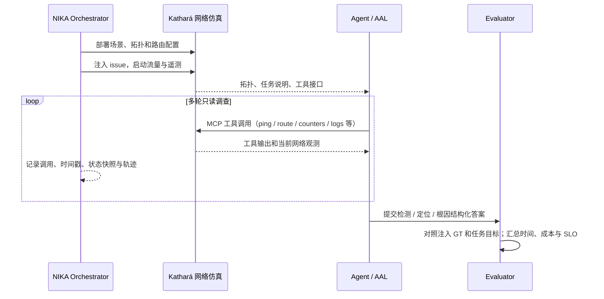

# NIKA：让网络故障诊断成为可交互的 Agent Benchmark

## 论文身份与阅读范围

- **论文标题：** *A Network Arena for Benchmarking AI Agents on Network Troubleshooting*
- **作者：** Zhihao Wang, Alessandro Cornacchia, Alessio Sacco, Franco Galante, Marco Canini, Dingde Jiang。
- **版本：** arXiv:2512.16381v1，2025-12-18；论文未列会议发表信息。[论文](https://arxiv.org/abs/2512.16381)
- **本地来源：** [PDF](../../../sources/papers/benchmark/NIKA_2512.16381.pdf) 与同目录全文文本。
- **阅读状态：** 完整阅读正文和任务/实验附录；没有运行仿真环境或 Agent。
- **源码范围：** [sands-lab/nika](https://github.com/sands-lab/nika) 当前主分支快照 `7324960044f7c524d86e4859a07f260a664f79ac`。论文 v1 的实验数据是 640 个配置、150 个实验子集；当前仓库持续扩展，不能把当前 README 的任务数量倒灌成论文数据。

## 1. 为什么需要 NIKA

网络运维不是静态问答：调查者可能需要识别是否异常、找出哪台设备/接口/链路受影响，再解释故障原因；可用证据分散在拓扑、路由/接口状态、ping/traceroute/iperf、流量统计和日志中。作者认为，既有网络基准要么封闭、难复现，要么集中于静态配置生成，因此无法比较 Agent 如何连续调查，也不会揭示诊断期间的耗时与网络服务影响。（§1–2）

NIKA 的关键选择是把 Agent 接入**仍在运行的可复现网络仿真场景**，给它受控诊断工具，并将每次调用和环境观测记录下来。它测的是工具辅助诊断，不是生产网部署，更不是自主修复安全基准。

## 2. 任务、环境与完整执行过程

论文把一个任务写成网络场景 (N)、故障 (I)、业务流量 (T) 与任务目标 (G) 的组合。目标 (G) 可分别要求异常检测、故障定位或根因诊断。论文包含 5 类网络场景、54 种 issue 类型、640 个基本任务配置；其中四类场景可扩展为小、中、大拓扑，平均约 11、27、101 个节点。研究者可以组合故障位置、流量以及参数形成变体。（§3，Table 1–2、Appendix A）

### 2.1 环境和故障怎么产生

论文使用 Kathará 网络仿真器；场景提供网络拓扑、设备协议配置、业务流量、故障脚本、遥测和诊断工具。流量通过 iperf3、ApacheBench 等产生；故障可由 `tc`、`stress-ng` 或设备/服务级脚本注入。Ground Truth 主要从注入规范得来：故障类型及目标设备、组件或资源就是可重复的答案标签。对于网络攻击/链路故障，目标可进一步对应接口、节点、链路等网络对象。（§3，Appendix A）

这种方法的优点是可控、可重复、可对比；局限是“脚本声明故障已注入”不等于故障行为已经在真实网络产生，也不等于根因由生产事件或盲标工程师独立确认。论文通过注入构造的是可重复的仿真标签，不能泛称为生产 Ground Truth。

### 2.2 Agent 得到哪些观测和工具

Agent Access Layer（AAL）通过 30 多个 MCP 工具暴露主动和被动检查，例如 ping、traceroute、iperf、shell/curl、接口/路由/设备状态、配置、计数器、日志和监控数据。工具可访问策略限制角色或资源。实验框架记录工具名称、参数、时间戳、响应和当时网络状态快照；Agent 的自然语言决策轨迹与工具结果可按时间线对齐。论文在 LangGraph/ReAct 框架中组织调查；诊断提交和结果评分是分开的步骤。

记录“用过某工具”仍不等于 Agent 正确解释了该观测。要把轨迹当作理由质量，还需要判断查询是否与根因有关、输出是否真的被后续推理使用；论文的主要贡献是留下审计材料并测量调查过程的成本/服务影响，而非对每条推理做严格因果验证。（§3.2–3.4，Fig. 2–4）

### 2.3 一个网络资源争用诊断例

论文的案例分析展示了资源争用问题：排队/丢包、链路 CRC 或不对称损失等证据同时可见。能力较强的 Agent 能使用应用层检查与低层网络工具交叉检查；较弱或调查不充分的轨迹停留在“链路不稳定/短暂拥塞”一类宽泛表述，没有进一步区分拥塞、错误计数和具体资源原因。这个例子说明，网络根因不是“发现丢包”就已完成：丢包可能是症状，定位需要对照端口计数、队列和端到端流表现。论文提供的是按模型/故障的诊断行为分析，不是每个实验的完整专家标注因果链。（§5.2，case analysis）

## 3. Ground Truth 与评估

论文实验从 640 个基础任务配置中抽取 150 个 incident，并为实验选取两个随机故障设备/组件实例以减少固定目标的偶然性。评测让 Agent 提交 goal 对应答案，再分别度量检测、定位和 RCA；此外记录调查耗时、输入/输出/推理 Token、工具调用次数与工具错误，并观察调查期间流延迟、丢包与用户定义 SLO 影响。（§4，Table 3–5）

主要模型结果如下（百分比）：

| 模型 | Detection | Localization | RCA |
| --- | ---: | ---: | ---: |
| GPT-OSS:20B | 19 | 5.5 | 5.5 |
| GPT-5-mini | 74 | 36 | 22 |
| GPT-5 | 89 | 68.7 | 55.3 |

不同目标是递进但不等价的：检测只需判断有无问题；定位需要指出目标；RCA 还需给出故障类型/原因。GPT-5 在该实验设置中从检测到 RCA 仍明显掉分，因此“能说出流量异常”不能代替“找出导致异常的点”。每项指标单位以论文表格为准；这些结果基于 150 个子集和该仿真工具栈，不能直接外推成生产网络准确率。

GPT-5 的单任务平均耗时约 359.2 秒、7 个步骤、28.4 次工具调用；论文还报告模型的 Token 消耗和工具错误率。网络规模从约 11 增至 101 节点时，检测相对稳定，但定位/RCA 变差，Token 消耗接近翻倍。该观察同时包含“可见拓扑更大”的负担与可能不同的任务构成，不能仅据此断言拓扑规模是唯一因果因素。（§5，Tables 4–6）

## 4. 评价例子与实验意义

假设（解释性示例，不是论文的单条结果）一个任务的 GT 是 `spine-2 / egress-interface / packet-loss`：Agent 只回答“链路有丢包”，可满足异常检测；如果它把对象定位成 `spine-2`，仍未必满足接口级定位；只有对指定接口和故障类型都答对，才能达到 RCA。与此同时，如果它用几十次重复 ping 才得到结论，答案正确但调查效率与服务影响仍需独立报告。

这正是 NIKA 同时保留答案和轨迹指标的理由。论文对网络诊断期间的 SLO 和链路表现进行测量，让“Agent 调查是否影响业务”成为评测对象；然而 Agent 只有诊断职责，论文不允许按最终结果评价修改路由、修复配置或回滚，因此没有证明这些工具操作在生产中安全。（§4–5）

## 5. 开放性与现实边界

- 论文公开代码、场景及超过 900 条 reasoning traces；固定版本比封闭企业评估更易复现。
- 网络是仿真环境而非硬件生产网；仿真器吞吐和协议/设备行为覆盖存在边界。
- 基于故障注入的标签具有因果可追溯性，但未经过生产事件标注流程；注入目标与最先出现影响的设备可能不同。
- 论文主要覆盖诊断，未评估 Agent 的修复动作、执行审批、修复失败回滚或恢复验证。
- 两个随机实例和 150 个案例支持比较，但对长尾网络故障、设备厂商差异和真实运维值班迁移仍需要外部验证。（§6）

## 6. 官方源码静态阅读与版本差异

论文指向 [LLM4NetLab / NIKA 项目](https://github.com/sands-lab/nika)。静态检查当前公开主分支，未执行安装脚本、容器、仿真或测试。

- `benchmark/working/pool/dc_clos/link_down.yaml`：案例将 `scenario`、`failure.fault_type`、可选的拓扑规模、注入参数和 `root_causes` 分开表示。例如 `link_down` 指定被断开的宿主接口，同时列出 canonical link 作为 GT。这个数据结构有助于区分**操作配置**与**提交标签**。
- `src/nika/problems/base.py`：`ProblemBase` 聚合故障类别、兼容场景、可枚举注入目标以及 ground-truth 生成约定；它反映当前任务生成能力已从论文固定任务表扩展。
- `src/nika/problems/rca/models.py`：`FaultResource` 将 node、interface、link 和 K8s 对象规范化为稳定 ID；`RootCause` 将 `(resource.id, fault_type)` 作为联合故障键。对于多根因/复合故障，这使实体和类型可分开评分。
- `src/nika/evaluator/scoring.py`：当前主分支对 detection 做二元正确性，对 RCA 将 `(resource.id, fault_type)` 转为集合计算 precision/recall/F1，同时单独给 localization 和 fault type 子指标。它与论文版本的 goal-specific 实验指标接口存在版本差异，不能用当前主分支结果反推论文 Table 4。
- MCP access/gateway 和 `src/nika/evaluator/` 是当前工具授权、提交与评分的核心目录。仓库也已有 Containerlab、Agent 沙箱和大量新增故障场景，这些是后续项目演进，不属于论文 640 个配置的实验声明。

SHA、核心模块与论文代码对应关系见[代码索引](../../../code/repository-index.md)。

## 7. 对 Network AIOps 的启发

网络数据集可以沿用“场景 + 故障/事件 + 业务流量 + 任务目标”的固定任务接口，并保存每轮工具操作与同步遥测。对传统模型和 Agent 可共享同一套根因实体与故障类别，但 Agent 需要额外报告检测延迟、证据覆盖、查询数量和诊断期间 SLO 变化。

要避免把模拟任务标签当作真实因果，应记录注入位置、实际受影响路径、告警/业务 SLI、证据来源、任务是否可解以及是否存在等价根因。按设备、接口、拓扑、协议和故障族留出测试集，比只随机抽样更能检验泛化。NIKA 提供可复现的互动协议，但我们的网络 AIOps 仍需补充真实设备/链路遥测、离线历史工单、多模态证据和安全修复评估。

关联：[RCABench](../rcabench/notes.md)、[CTBench](../ctbench/notes.md)、[AgenticOpsEval](../agenticopseval/notes.md) 与[综合比较](../../../notes/benchmark/benchmark-comparison.md)。
