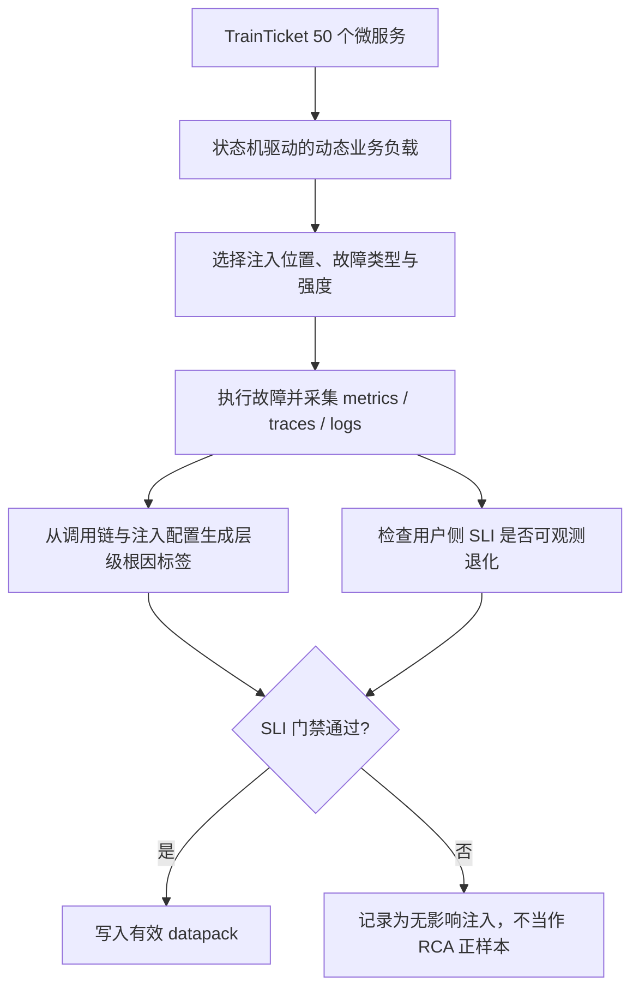

# RCABench：让微服务 RCA 基准中的故障传播变得可测

## 论文身份与阅读范围

- **论文标题：** *Rethinking the Evaluation of Microservice RCA with a Fault Propagation-Aware Benchmark*
- **作者：** Aoyang Fang, Songhan Zhang, Yifan Yang, Haotong Wu, Junjielong Xu, Xuyang Wang, Rui Wang, Manyi Wang, Qisheng Lu, Pinjia He。
- **版本：** arXiv:2510.04711v2，2025-12-23；另核对 FSE 2026 正式发表版（PACMSE FSE072，2026-07，DOI 10.1145/3797100）。[正式版 PDF](https://yifanyang6.github.io/assets/pdf/papers/fang2026rethinking-fse.pdf)。下文新增定位标为 FSE，旧统计同时保留 arXiv v2 的来源口径。[论文与修订记录](https://arxiv.org/abs/2510.04711)
- **本地来源：** [论文 PDF](../../../sources/papers/benchmark/RCABench_2510.04711.pdf)；同目录 `.txt` 为本地 HTML 派生全文。
- **阅读状态：** 本轮完整阅读论文正文、主要表图和讨论附录；没有运行故障注入、基线或集群。
- **代码来源：** 论文项目迁移至 [OperationsPAI/Aegis](https://github.com/OperationsPAI/aegis)。本轮静态检查的仓库快照为 `979ae7011d06d21925001ce517ed40cedca529b0`；旧平台仓库 [OperationsPAI/AegisLab](https://github.com/OperationsPAI/AegisLab) 在 `a55646d66fef51c3cd11e67ccebfae5d62ac6f9b` 归档。当前源码形态已经演进，不能当成论文实验版逐行复现。

## 1. 问题与主张

作者质疑的是“算法在公开基准上的高分是否表示它确实找到了根因”。在四个已有微服务 RCA 数据集上，作者发现极简单的规则方法 SimpleRCA 有时与 SOTA 持平或更好。其诊断是：一些注入任务让根因服务自身出现最强、最明显的信号，因此模型只要抓住最显眼的服务症状就可以答对；这没有充分测试故障如何沿依赖传播、以及根因和症状分离时能否回溯。

论文将既有问题分为三类：注入故障未命中实际执行路径；调用图与工作负载没有覆盖丰富依赖；多模态遥测中的根因信号和异常表现过于直接。作者不是提出一个新 RCA 算法，而是提出一个**自动生成并筛选有业务影响的故障案例**的框架，再用传统方法检验新基准的难度。论文主要结论是：仅有注入记录并不足以称为有效故障样本，应该保留注入尝试、可观测影响和根因标签之间的关系。（§1–3，Fig. 1，Table 1）

### 旧基准审计和 SimpleRCA（FSE §3.1.2、§3.2、Table 3、Fig. 2）

SimpleRCA 对服务指标用历史 3σ/P95 一类阈值，对 trace 检测服务 P95 延迟相对正常期的倍增，对日志计数错误关键词，再按各服务的告警数排序。它没有沿因果链回溯的组件，因此其高分可以暴露「症状最响的服务就是根因」的测试捷径。

作者按显著症状位置将 737 个案例分成 Type I（仅注入服务显著）、II（所有服务均不显著）和 III（其他服务出现更强症状）。按作者的检测规则，I/II 合计约 86%，约 99% 缺少至少一种所需可观测模态；只有 RE2-OB 的 4 例达到全面观测标准。该比例依赖阈值、日志计数和审计样本。Fig. 2 的 Eadro CPU 案例在注入服务看到突升，安全和车站服务曲线相对平坦，解释了局部显著性基线为何有效。

## 2. 基准怎样构建：从一次注入到可评估案例

### 2.1 环境、工作负载与遥测

测试床为 TrainTicket，包含 50 个服务。作者加入状态机驱动的动态工作流，而不只重复一个静态请求；一个订票工作流可由 分别为 passenger、seat、insurance 选择满足前置参数的途径（对应 6、3、2 种组合因素）组合为 36 条路线。目标是让服务调用覆盖更广，避免故障方法落在请求永远不会经过的函数上。请求平均负载约 16.47 QPS、峰值约 37.6 QPS；最终数据记录 188.1 小时、1.547 亿条日志、1,120 万条 trace、78 类指标，服务覆盖 42/50，最大调用深度 7、最长 trace 20 个 span。（arXiv v2 §4.3 Fig. 4，数据统计见 §6.1）

采集包括 Prometheus 指标、OpenTelemetry traces、与 trace 关联的日志、L4/L7 网络遥测和调用拓扑；数据汇入 ClickHouse，供后续算法读取。时间跨度、工作负载和模态组合增加了实验复杂度，但这些统计不等于每个案例都具备全部模态或所有根因层级。

### 2.2 故障空间与“有效注入”

框架初始设计 31 种故障类型，覆盖资源、网络、HTTP、代码/JVM、DNS、时间等类别，并在服务、容器、方法等候选点位上采样；论文表格有六个可见类别，正式版统一采用六类口径。注入参数组合空间超过 (10^{16})，所以实际以分层随机样本探索，而非穷举。9,152 次尝试最终保留 1,430 个有效案例、25 种故障类型。初始尝试中 84.4% 没有形成可检测的异常；CPU / 内存压力等故障的强度需要调校，部分 JVM 故障目标函数从未被当前工作负载调用，因此无论注入配置如何都不会成为有效事件。（arXiv v2 §4.4、§4.7–4.8、§6.1.1 Fig. 7）

举例说明“注入成功”和“故障成立”不是一回事：论文报告 `HTTPRequestAbort` 的尝试中 100% 被 SLI 标为有影响、`HTTPResponseReplaceCode` 为 98%；相较之下，目标函数未被请求触达的 JVM 故障即使工具显示已施加，也不能代表业务路径发生退化。前两项说明明显中断更容易触发用户侧信号；后者揭示需要把**实验动作日志**和**实测影响**分别留档。这个例子是论文按故障类型汇总的统计，并非声称某一条完整的生产事件记录。（arXiv v2 §6.1.1 Fig. 7）

### 2.3 SLI 门禁与 Ground Truth

论文用用户可见服务级指标作注入筛选 oracle，主要观察成功率与延迟。成功率通过注入前后请求成功情况的统计检验判断；延迟则对比绝对阈值（如 10 秒）与历史自适应阈值。门禁旨在过滤“脚本执行了、但请求没有受到可辨影响”的样本，而不是证明注入点是现实系统唯一根因。论文的算法描述没有把每一种测试案例都解释成用户体验完全一致的故障类型。（§4.7）

标签从注入参数锚定细粒度原因，再按包含关系表达根因的不同粒度：方法/函数、容器/Pod、服务及相应指标或 span。细标签意味着粗标签，例如函数级故障可映射到所在服务。需要注意：论文在基准实验中为了与 11 个传统算法公平比较，主要只评到各数据集共有的服务级标签；所以完整层级 GT 的潜力并未完全反映在主表的 Top@K 分数里。（§4.6；arXiv v2 Fig. 6 / FSE Fig. 5）

### 环境隔离、标签边界与难度（FSE §4.3、§4.6–4.7、§5、§7.2.1）

每轮先预热 4 分钟，再收集正常期和故障期各 4 分钟，随后重新部署服务，降低跨事件干扰。对 Art、DiagFusion、Eadro 等需训练者，文中称按故障类型做 80/20 训练与测试划分。原文未在此给出每个模板和目标的拆分清单。负载图中的节点是请求所需参数，边是满足参数的方法。创建或查询对象可能递归触发前置工作流，使静态负载从未覆盖的函数得以执行。

注入参数产生 service/pod/container/function 等根因定位标签。标签树表示同一根因的粒度，整条已观测传播链、每条边的证据和时间仍需独立标注。入口 SLI 门禁可能漏掉被容错吸收、局部用户退化或尚未形成明显入口影响的灰色故障。作者在正式版提出两条难度轴：根因到最强症状的图距离，以及因果路径上遥测缺失或相互矛盾的节点占比。两者是研究建议，主结果未用它们给每例打分。

## 3. 评价任务、指标与一例计算

实验把每个案例表示为一个故障窗口，算法返回排序后的根因服务。最主要指标为：

- **Top@K**：预测前 K 个候选中是否至少包含真实根因；单根因情形为
  \[
  \operatorname{Top@K}=\mathbf{1}[r^*\in \hat R_{1:K}].
  \]
- **MRR**：每个案例按真实根因首次出现排名的倒数取平均，若排名为 4，则该例贡献 (1/4)。它奖励把真根因往前排，但不表示整个候选列表具有可解释因果链。
- **运行时间**：作为可用性/计算规模的补充，不与诊断质量合并成一个“智能”分数。

例如（解释性计算，非论文单条案例）：真实根因是 `checkout`，算法输出 `frontend, cart, checkout`，则 Top@1=0、Top@3=1、RR=1/3。若真实根因只是“服务 checkout”，这样的排序仍无法判断模型是否看见了哪条传播证据，也未评价多根因完整性、证据可信度或修复安全。评分见实验设置和结果表。

比较了 11 个传统 RCA 方法，使用论文描述的官方实现/建议参数，并做尽力调参。论文以此测试新基准是否对已有算法更难；没有 LLM Agent、工具调用、调查轨迹或安全修复任务。（§5.2–5.3）

## 4. 实验发现：难度提升来自什么

在四个老数据集的初步比较中，SimpleRCA 使用指标阈值、trace 延迟和日志关键词等浅层信号，能达到或超过一些复杂方法；作者用这个现象说明原基准可能将根因异常与最明显症状绑定。新数据上的平均 Top@1 为 0.21，最佳方法 MicroRCA 为 0.37；SimpleRCA 为 0.28。这里的低分不是单独证明数据集更“真实”，而是与作者的设计目标相符：算法不能普遍靠一个强根因信号解决。（§3.2.2 Table 2、§6.2.1）

类别分析显示，显眼的 `ContainerKill` / JVM 内存等故障可被简单规则较好定位；网络损坏、DNS 随机错误和时间偏移更容易成为盲区。比如 `HTTPRequestAbort` 的 SimpleRCA Top@1 仅 0.13、Top@5 达 0.93，说明真实候选往往已被排入前五，却没被排到第一；与“是否进入候选集”相比，“是否排序到最前”是不同失败。（§6.2.3，arXiv v2 Fig. 11 / FSE Fig. 9）

这些结果支持“当前公开数据集上的离线准确率对基准构造敏感”，但并未直接证明某个方法在生产运维中会变差。系统只使用一个可控测试床，工作负载/故障空间仍是作者设计的代理；Top@K/MRR 不评价证据链是否完整、根因解释是否被操作员接受，作者也承认复杂度代理指标不是 RCA 难度本身。（§7.1 Threats to Validity）

### 失败机制与原文案例（FSE §6.2.4、Figs. 10–11）

作者对 262 个难例进行多标签归因，因此图中比例的分母是归因标签数。三大类是可扩展性（数据量增大后诊断延迟失去实用性）、可观测盲区（信号消失、基建未监控、日志与 trace 语义冲突）和建模瓶颈（模型假设不适用于减法型故障）。例如 PodKill 使遥测停止，Nezha 一类基于事件频率增加的模型可能把沉默当正常；基础设施故障则可能只留上层症状。论文给出了该失效机制及 Eadro 的实测对照案例；尚缺可串起同一新基准样本的注入参数、逐跳遥测、SLI 判定和算法输出的完整记录。

## 5. 核心源码静态阅读

论文项目已并入 [Aegis](https://github.com/OperationsPAI/aegis)；它当前把平台和算法基准 SDK 放在一个仓库。静态读取重点是仓库 README、`rcabench-platform` 的评估、采样和因果推理目录，没有安装依赖或运行代码。

- `rcabench-platform/src/rcabench_platform/v3/internal/reasoning/algorithms/temporal_validator.py`：检查状态时间线是否能支持传播边。观测到的窗口按来源 onset 和 `epsilon_eff` 做时间先后门限；`inferred` / `structural` 窗口没有独立实际时间含义，按证据级别单独处理。这是“传播链时间一致性”实现，不是论文中筛选 injection 的 SLI oracle。
- `rcabench-platform/src/rcabench_platform/v3/sdk/samplers/metrics_sli.py`：将 trace 按服务、span、分钟聚合，生成 min/max/mean、P50/P90/P95/P99、总量和错误计数。这是下游 RCA 的 SLI 特征，不等同于“检验注入前后服务 SLI 是否过门槛”。
- `rcabench-platform/src/rcabench_platform/v3/sdk/evaluation/{ground_truth.py,evaluator.py,graph_match.py}`：当前代码能够由 injection 元数据解析 GT fault，比较候选集合/传播图，并可对声明的 SQL evidence 作可执行性和支持度核验。此 schema 属于现行平台版本，不可直接当成论文 Table 6 的评分代码。
- `aegislab/`：当前公开平台 README 表明其运行“build → inject → collect”，将 fault injection 和观测打包成携带 GT 的 datapack，再交给 `rcabench-platform` 评算法。具体 SLI 筛选逻辑在本轮检查到的当前公开路径中没有找到可按论文复现的直接实现。

## 6. 对网络 AIOps 的启发

可借鉴的不是“多注入几种故障”，而是把一次事件拆成多个可追溯状态：计划注入、实际命中、遥测异常、用户/业务影响、标签生成、纳入/排除决定。对于网络场景，应以业务探针/流量 SLO 验证链路和设备故障是否可感知，并保留被排除的静默注入用于分析，不将其和有效故障混算。

层级 GT 可以映射为设备/接口/链路/协议对象/指标，传播可以表示为“故障源→中间设备或链路→受影响流/业务”。但注入点不一定是拓扑上的最早影响点；一个接口注入可能造成多个节点症状，故真实传播边需要遥测、拓扑、路由状态或人工证据支持。对于我们的数据集，还需要按故障模板、设备角色、拓扑和负载分组切分来排除可记忆的模板关联。上述切分和负对照是后续建议，并非本论文已证明存在某种泄漏。

关联： [NIKA](../nika/notes.md) 的可交互网络环境、[AgenticOpsEval](../agenticopseval/notes.md) 的证据标签与 [Benchmark 综合报告](../../../notes/benchmark/reviews/benchmark-review-v1.md)。完整项目 SHA 及源码映射见[代码索引](../../../code/repository-index.md)。
